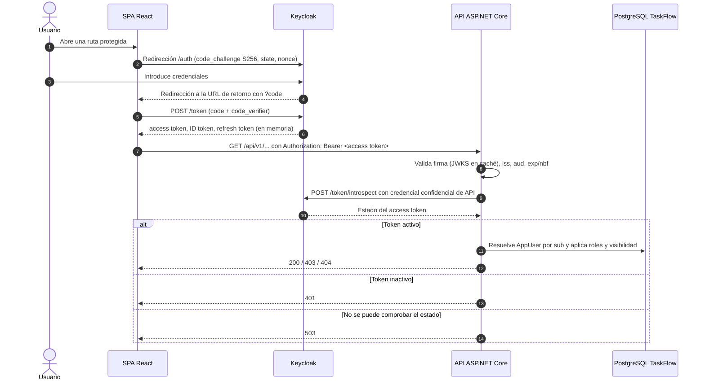
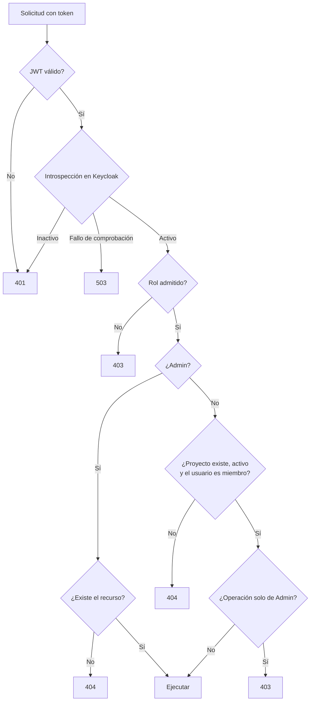

# TaskFlow — Autenticación, identidad y permisos

> **Responsable:** conjunto — backend (validación de tokens y políticas) y frontend (flujo OIDC y sesión en la SPA)
>
> **Estado:** implementados JWT Bearer, roles de realm, usuario local, `/api/v1/me` e introspección por petición. Las pruebas HTTP utilizan tokens RSA firmados y un proveedor simulado; la comprobación conjunta con el Keycloak y la SPA reales sigue pendiente.
>
> **Coherencia:** se actualiza este documento del equipo; los originales del manager quedan pendientes de aprobación según [documentation-alignment.md](documentation-alignment.md).
>
> **Fuentes:** [requisitos FR-001 a FR-003 y §3](../02-requirements/functional-requirements.md) · [visión general del sistema §4 y §5](system-overview.md) · [modelo de datos](database.md)

## 1. Alcance

Este documento concreta cómo se autentican los usuarios de TaskFlow, cómo se configura Keycloak, cómo llegan los roles `Admin` y `User` a la API y cómo se aplican los permisos por rol y por pertenencia a proyecto. Los nombres de realm, cliente SPA y audiencia están confirmados con frontend. La revocación queda definida en §5 por indicación del usuario. El estado de implementación y las comprobaciones pendientes se detallan en §10.

## 2. Flujo de autenticación

Se acuerda OIDC Authorization Code con PKCE `S256`. La SPA es un cliente público (sin secreto) y mantiene los tokens solo en memoria.

1. La SPA usa `keycloak-js` con `pkceMethod: 'S256'`.
2. El access token se envía a la API en cada solicitud. **El ID token nunca se envía a la API**: solo sirve a la SPA para conocer al usuario y para el cierre de sesión.
3. La API obtiene metadatos OIDC y claves públicas (JWKS), admite rotación de claves y valida el JWT localmente. Después consulta su estado en Keycloak en cada petición protegida, según §5, antes de resolver el usuario local o ejecutar operaciones de negocio.
4. Antes de enviar una petición, la SPA renueva con `updateToken(30)` si quedan menos de 30 segundos de token. Coordina una sola renovación simultánea por instancia y utiliza el nuevo refresh token cuando hay rotación. Si ya no puede renovar la sesión, limpia tokens y caché protegida y vuelve al login.
5. Después del login y de renovar el token, la SPA consulta `GET /api/v1/me`. No reenvía automáticamente escrituras ya enviadas; los reintentos de lecturas se configuran aparte.

Referencias: [adaptador JavaScript de Keycloak](https://www.keycloak.org/securing-apps/javascript-adapter) · [autenticación JWT Bearer en ASP.NET Core](https://learn.microsoft.com/en-us/aspnet/core/security/authentication/configure-jwt-bearer-authentication).

## 3. Configuración acordada de Keycloak

| Elemento | Acuerdo | Notas |
|---|---|---|
| Realm | `taskflow` | Un único realm y emisor por entorno. Exportación versionada sin secretos ni contraseñas reales. |
| Cliente SPA | `taskflow-spa`, público, Standard Flow activado, PKCE `S256` obligatorio | Direct Access Grants e Implicit Flow desactivados. |
| URL de retorno | En local, `http://localhost:5173/callback`; después del logout, `http://localhost:5173/` | Las URL del despliegue se fijarán al preparar ese entorno. |
| Web origins | En local, `http://localhost:5173` | Origen exacto para Keycloak y CORS de API, sin comodines generales. |
| Audiencia de la API | `taskflow-api` | Se añade al `aud` del access token mediante un mapper de audiencia en un client scope asignado a `taskflow-spa`. Sin él, la API rechazaría el token. |
| Cliente confidencial de API | `taskflow-api`, con autenticación de cliente activada | Su secreto solo está en el servidor. Se usa para introspección y debe coincidir con la audiencia del token; no requiere permisos de administración del realm. |
| Roles | Roles de realm `Admin` y `User` | Cada usuario de demostración tiene exactamente uno. |
| Usuarios de demostración | «Admin», «Usuario A», «Usuario B», «Usuario C» | Contraseñas fuera de Git; véase §6. |
| Registro de usuarios | Habilitado (*User registration*) | La SPA solo redirige (RegisterPage → `keycloak.register()`); véase [frontend.md §3.2](frontend.md). |
| Rol por defecto | `User` incluido en los roles por defecto del realm | Todo usuario registrado recibe `User`; `Admin` solo se asigna manualmente. |

### Vigencia de tokens y sesión

| Parámetro | Acuerdo |
|---|---|
| Access token | 5 minutos. |
| Sesión SSO inactiva | 30 minutos de inactividad de sesión; la renovación también cuenta como actividad. |
| Sesión SSO máxima | 10 horas, confirmadas por frontend para conservar el valor predeterminado de Keycloak. |
| Rotación del refresh token | Activada; renovaciones coordinadas y comprobación con varias pestañas durante la implementación. |
| Tolerancia de reloj de API | 30 segundos. |

La renovación está sujeta a los límites de sesión SSO. Las 10 horas máximas no son la duración de cada access token. Véanse la [configuración de sesiones de Keycloak](https://www.keycloak.org/docs/latest/server_admin/#_timeouts) y el [valor predeterminado de Keycloak 26.8.1](https://github.com/keycloak/keycloak/blob/26.8.1/server-spi-private/src/main/java/org/keycloak/models/Constants.java#L62-L63).

## 4. Validación del token en la API

La API configura el esquema JWT Bearer con:

- **Emisor (`iss`)**: el emisor público del realm. Debe coincidir exactamente con el que aparece en los tokens.
- **Audiencia (`aud`)**: `taskflow-api`.
- **Firma**: claves del JWKS del emisor; solo algoritmos asimétricos.
- **Vigencia**: `exp` y `nbf`, con una tolerancia de reloj explícita de 30 segundos.
- **Estado en Keycloak**: introspección obligatoria con `active: true` en cada petición protegida, antes de permitir acceso a datos de negocio. La tolerancia de reloj local no retrasa la revocación.

**Emisor en desarrollo con Aspire.** El AppHost iniciará API y Vite como procesos del equipo, y PostgreSQL y Keycloak como contenedores. Se conservarán los puertos públicos acordados: SPA 5173, API 5080 y Keycloak 8080; el emisor será `http://localhost:8080/realms/taskflow`. Aspire puede descubrir direcciones internas, pero los valores públicos OIDC deben seguir coincidiendo con `iss`, el callback y los orígenes registrados.

Keycloak accederá a su base PostgreSQL por la red de contenedores; la API usará la conexión inyectada por AppHost. La configuración de endpoints se verificará en fase 1 según [environment-setup.md](../04-development/environment-setup.md). Si se cambia la distribución a API en contenedor, se revisará la conectividad sin desactivar la validación del emisor.

### Mapeo de roles

Keycloak incluye los roles de realm en la reclamación anidada `realm_access.roles`, que ASP.NET Core **no** convierte automáticamente en roles. Se acuerda una transformación de reclamaciones (`IClaimsTransformation`) que:

1. Lea `realm_access.roles`.
2. Añada una reclamación de rol solo para los valores admitidos (`Admin`, `User`) e ignore el resto.
3. Si no hay ningún rol admitido, no añada ninguno; las políticas responderán HTTP 403 (FR-003, BR-010).

Si un usuario tuviera ambos roles por error de configuración, prevalece `Admin`; se documentará como incidencia de configuración.

### Políticas y precedencia acordadas

| Política | Requisito | Uso |
|---|---|---|
| `AuthenticatedUser` | JWT válido, introspección activa y rol `Admin` o `User` | Todas las operaciones de negocio. Política predeterminada. |
| `AdminOnly` | Rol `Admin` | Directamente en listas administrativas sin recurso concreto. Para archivar, restaurar o eliminar por identificador, comprobar antes visibilidad en el caso de uso y exigir después el rol. |

La comprobación por recurso se coordina en `Application`, filtrando por el usuario actual antes de exigir el permiso administrativo. Una política `AdminOnly` en un endpoint con identificador no debe anticipar un 403 que impida el 404 acordado para recursos no visibles. Las pruebas verificarán esta precedencia; listas y panel sin resultados mantienen 200.

## 5. Cierre de sesión y revocación acordados

**Decisión cerrada el 2026-10-23 por indicación del usuario:** Keycloak gestiona la revocación; la API conserva la validación local del JWT y consulta además su estado mediante introspección en cada petición protegida. Se descarta admitir un token únicamente porque aún no haya caducado si Keycloak ya lo considera inactivo.

1. Al cerrar sesión, la SPA solicita finalizar la sesión en Keycloak y elimina sus tokens en memoria y la caché protegida. Borrarlos solo en la SPA no revoca la sesión del servidor; la finalización en Keycloak debe completarse.
2. La API llama a `POST /realms/taskflow/protocol/openid-connect/token/introspect` con el access token y autenticación del cliente confidencial `taskflow-api`. Su secreto se inyecta en la API desde configuración segura; nunca se entrega a la SPA ni se versiona.
3. Solo `active: true` permite continuar con roles y permisos. Un token inactivo devuelve 401, sin ejecutar el caso de uso. Esto incluye una sesión finalizada o revocada administrativamente que Keycloak ya reconozca como inactiva.
4. Si la consulta no puede completarse —indisponibilidad, tiempo de espera agotado, respuesta inválida o fallo de autenticación del cliente servidor—, la API rechaza la operación con 503 y Problem Details sin detalles internos. No continúa usando únicamente la validación local. Se configura un tiempo de espera acotado para la llamada.
5. No se comparten resultados de introspección entre peticiones ni se almacenan resultados positivos en caché. Basta una consulta por petición, aunque la autenticación se evalúe varias veces dentro de ella. La caché de claves JWKS sí se conserva.
6. `/health` es anónimo y no requiere introspección. Las solicitudes autorizadas antes de completar el logout no se cancelan retroactivamente.

La garantía se comprueba reutilizando exactamente el mismo access token: debe admitirse antes del logout y rechazarse con 401 en la siguiente petición iniciada después de que Keycloak haya completado el cierre de esa sesión. Se repite la prueba revocando la sesión desde la administración de Keycloak. No se equipara revocar solamente un refresh token con invalidar automáticamente todos los access tokens.

Se mantienen access token de 5 minutos, inactividad SSO de 30 minutos y sesión máxima de 10 horas. La decisión añade una llamada de red y dependencia de Keycloak por petición protegida. No se incorpora una lista propia de revocación.

Referencias: [endpoints OIDC de Keycloak](https://www.keycloak.org/securing-apps/oidc-layers) e [introspección de Keycloak 26.8.1: sesión, revocación y audiencia del cliente](https://github.com/keycloak/keycloak/blob/26.8.1/services/src/main/java/org/keycloak/protocol/oidc/AccessTokenIntrospectionProvider.java).

## 6. Usuarios de demostración y correspondencia con `AppUser`

| Usuario | Rol | Uso en los recorridos |
|---|---|---|
| Admin | `Admin` | Recorrido E: ve todo, archiva, restaura y elimina |
| Usuario A | `User` | Recorrido A: crea el proyecto y asigna |
| Usuario B | `User` | Recorrido B: recibe la asignación y colabora |
| Usuario C | `User` | Recorrido C: comprueba que no ve proyectos ajenos |

Se acuerda preparar usuarios de demostración para asignarles tareas antes de su primer acceso:

1. La exportación del realm fija el identificador de cada usuario de demostración, de modo que su `sub` sea conocido y estable.
2. Una semilla de datos de la API crea los `AppUser` con esos `keycloak_sub`, `display_name` y `email`.
3. Las contraseñas de demostración no se versionan: se definen por variables de entorno o se establecen tras la importación, según la guía de entorno.

**Usuarios registrados:** como el registro está habilitado, la API crea el `AppUser` en la primera solicitud de un usuario autenticado con rol admitido que no lo tenga (con `sub`, nombre y correo del token). Esto no le concede acceso a ningún proyecto ajeno: no tiene pertenencias. La creación debe ser idempotente ante solicitudes simultáneas (unicidad de `keycloak_sub`). Mientras no haya iniciado sesión por primera vez, un usuario registrado no aparece en la lista de asignables.

### Perfil local y ciclo de vida acordados

- Resolver siempre por `sub` validado; no identificar usuarios por correo o nombre.
- Crear la referencia en el primer acceso y sincronizar nombre y correo desde el token al consultar `/me`, escribiendo solo si cambian.
- Para el nombre, preferir `name`, después `preferred_username` y, como reserva, `Usuario` más parte del UUID local; recortar y limitar la copia visible a 200 caracteres.
- El correo es opcional; ausente, inválido o de más de 320 caracteres se guarda como `NULL`. Los roles se leen de cada token y no se persisten.
- La introspección impide operar con un token que Keycloak considere inactivo tras eliminar o deshabilitar la identidad. Conservar referencias, pertenencias, autorías y tareas cuando se elimina o deshabilita la identidad en Keycloak. Se acepta que pueda seguir apareciendo en asignables, ya que el MVP no sincroniza su estado de actividad.
- El borrado local es una operación distinta, mediante el procedimiento de mantenimiento con protección del último miembro descrito en [database.md §5](database.md).

## 7. Autorización por pertenencia

Resumen de la matriz de los [requisitos §3](../02-requirements/functional-requirements.md):

| Operación | `Admin` | `User` |
|---|---|---|
| Ver proyectos y tareas | Todos (archivados en vista aparte) | Proyectos activos de los que es miembro |
| Crear proyecto | Sí | Sí (pasa a ser miembro) |
| Editar proyecto | Cualquiera | Proyectos activos de los que es miembro |
| Archivar, restaurar, eliminar proyecto; ver archivados | Sí | No |
| Crear, editar, eliminar, asignar y cambiar estado de tareas | Cualquier proyecto | Proyectos activos de los que es miembro |

Flujo de cada solicitud de `User` sobre un proyecto o tarea:

Reglas de implementación:

- La identidad siempre procede del `sub` del token validado, resuelto a `AppUser`. Ningún identificador de usuario, creador o miembro enviado por la SPA sirve como prueba de identidad.
- La visibilidad se aplica en la consulta (unión con `AppUser_Project` y `archived_at IS NULL`), no filtrando resultados ya cargados.
- Para un recurso concreto, inexistencia o falta de visibilidad responden con el mismo 404 antes de comprobar si la operación exige `Admin`. Si el recurso es visible pero la operación está prohibida, se devuelve 403.
- Listar archivados exige `Admin` sin recurso individual; `User` recibe 403. Las listas y el panel ordinarios sin datos visibles devuelven 200.
- Las altas de pertenencia (crear proyecto, asignar a un no miembro) se hacen en el servidor, en la misma transacción.
- La interfaz oculta o desactiva los controles no permitidos según el rol recibido en `GET /api/v1/me`, pero la API vuelve a comprobarlo todo.

## 8. Seguridad en el navegador

- Tokens solo en memoria; nunca en `localStorage`, `sessionStorage` ni cookies accesibles desde JavaScript.
- Todas las variables incorporadas al bundle de la SPA son públicas: solo URL de Keycloak, realm, `client_id` y URL de la API. El secreto de introspección permanece en la API; no se envía al navegador ni se registra junto con los tokens.
- CORS en la API admite únicamente el origen de la SPA de cada entorno; no sustituye la autenticación.
- HTTPS obligatorio en AWS para SPA, API y Keycloak. La consola de administración de Keycloak no se expone públicamente.

## 9. Pruebas previstas

- Solicitud sin token o con token mal formado → 401.
- Token con firma, emisor o audiencia incorrectos, o caducado → 401.
- Token válido sin rol admitido → 403.
- `User` accede a un recurso concreto ajeno o archivado, incluso en una operación administrativa → 404.
- Listas y panel sin datos visibles → 200 con lista vacía o recuentos cero; un filtro que identifica expresamente un proyecto no visible → 404.
- `User` miembro intenta archivar o eliminar un proyecto activo visible → 403; restaurar un proyecto archivado no visible → 404.
- `User` solicita la lista administrativa de archivados → 403.
- `User` crea proyecto → queda como miembro; asigna a un no miembro → este pasa a verlo.
- Cierre de sesión: la SPA borra tokens y caché; tras completar el logout no se renueva esa sesión. Reutilizar el mismo access token admitido antes del cierre devuelve 401 después; comprobar también la revocación administrativa de la sesión.
- Keycloak no disponible, tiempo de espera agotado, respuesta inválida o credencial confidencial incorrecta → 503, sin ejecutar escrituras ni crear o sincronizar el perfil local. No se reutiliza una introspección positiva de otra petición.
- `/health` sigue sin requerir token ni introspección; sus comprobaciones de salud conservan su propio resultado.
- Alta local concurrente sin duplicados, sincronización desde `/me`, valores de reserva y conservación de referencias de identidades deshabilitadas.

## 10. Estado y trabajo pendiente

Realm, cliente SPA, audiencia, biblioteca `keycloak-js`, PKCE, tokens en memoria, tiempos de sesión (5 minutos / 30 minutos / 10 horas), rotación, llamadas a `/me`, perfil local y precedencia 404/403 están acordados. El entorno de desarrollo se orquesta con Aspire.

La API registra JWT Bearer con discovery/JWKS, emisor y audiencia configurados, firma RS256 (algoritmo del realm versionado), caducidad y tolerancia de 30 segundos. `KeycloakRolesTransformation` admite únicamente `Admin` y `User` de `realm_access.roles`; las políticas predeterminada y de respaldo exigen uno de ellos.

Tras validar el JWT se consulta introspección sin caché entre peticiones. Inactivo produce 401; fallo HTTP, respuesta inválida, ausencia de secreto o tiempo de espera agotado produce 503. No se resuelve ni escribe el usuario local en esos casos. `/health` y OpenAPI en Development son anónimos; las rutas de ejemplo Ping y WeatherForecast quedan protegidas por la política de respaldo.

`LocalUserMiddleware` resuelve `AppUser` por `sub` después de autorizar la petición y completa el `ICurrentUser` del ámbito. `AppUserRepository` utiliza `INSERT ... ON CONFLICT (keycloak_sub) DO NOTHING` para coordinar primeros accesos simultáneos. `/api/v1/me` sincroniza el perfil solo si cambia y devuelve los roles actuales sin persistirlos. AppHost comparte con la API el parámetro secreto ya utilizado por el cliente confidencial de Keycloak. El detalle de archivos y la prueba manual están en [la guía de entorno](../04-development/environment-setup.md#61-autenticación-y-perfil-local).

Se incluyen pruebas HTTP con tokens firmados y respuestas simuladas de introspección, y pruebas con PostgreSQL 18.6 para alta concurrente y salud anónima. La comprobación real de login, renovación, logout y revocación administrativa queda pendiente de ejecutar junto con la rama de frontend y el entorno Keycloak. La semilla de usuarios de demostración y los permisos por pertenencia de los endpoints de negocio no se implementan con este cambio. Estos avances no cierran por sí solos ISS-06, ISS-12 ni ISS-13.

Los documentos originales del manager siguen sin editar hasta su aprobación. Las discrepancias pendientes de trasladar se registran en [documentation-alignment.md](documentation-alignment.md).
