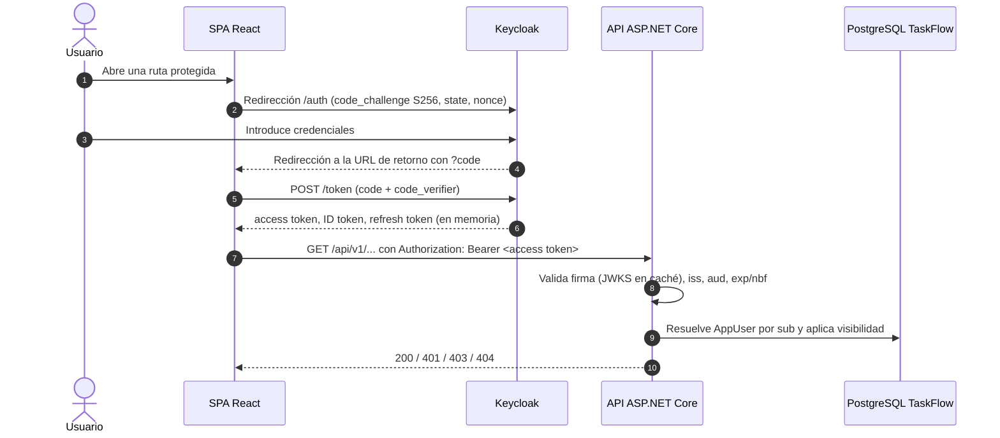
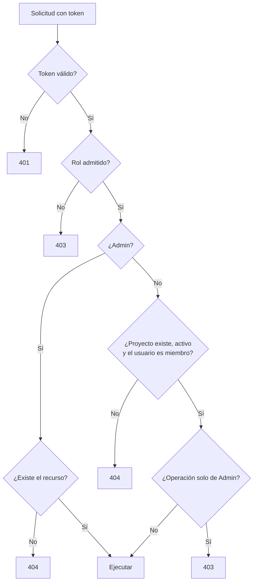

# TaskFlow — Autenticación, identidad y permisos

> **Responsable:** conjunto — backend (validación de tokens y políticas) y frontend (flujo OIDC y sesión en la SPA)
>
> **Estado:** borrador de fase 0; propuesta pendiente de aprobación. No hay Keycloak configurado ni código implementado.
>
> **Fuentes:** [requisitos FR-001 a FR-003 y §3](../02-requirements/functional-requirements.md) · [visión general del sistema §4 y §5](system-overview.md) · [modelo de datos](database.md)

## 1. Alcance

Este documento concreta cómo se autentican los usuarios de TaskFlow, cómo se configura Keycloak, cómo llegan los roles `Admin` y `User` a la API y cómo se aplican los permisos por rol y por pertenencia a proyecto. Los nombres de realm, clientes y ámbitos que aparecen son **propuestas de ejemplo** hasta que se aprueben en fase 0.

## 2. Flujo de autenticación

Se propone OIDC Authorization Code con PKCE `S256`. La SPA es un cliente público (sin secreto) y mantiene los tokens solo en memoria.

1. La SPA usa el adaptador JavaScript de Keycloak (u otra biblioteca OIDC certificada que se apruebe) con `pkceMethod: 'S256'`.
2. El access token se envía a la API en cada solicitud. **El ID token nunca se envía a la API**: solo sirve a la SPA para conocer al usuario y para el cierre de sesión.
3. La API descarga los metadatos OIDC y las claves públicas (JWKS) del emisor y los guarda en caché; no llama a Keycloak en cada solicitud. Debe soportar la rotación de claves.
4. Antes de que caduque el access token, la SPA lo renueva con el refresh token (`updateToken`). Si la renovación falla, borra los datos protegidos y vuelve a iniciar sesión (FR-002).

Referencias: [adaptador JavaScript de Keycloak](https://www.keycloak.org/securing-apps/javascript-adapter) · [autenticación JWT Bearer en ASP.NET Core](https://learn.microsoft.com/en-us/aspnet/core/security/authentication/configure-jwt-bearer-authentication).

## 3. Configuración propuesta de Keycloak

| Elemento | Propuesta | Notas |
|---|---|---|
| Realm | `taskflow` (ejemplo) | Un único realm y emisor por entorno. Exportación versionada sin secretos ni contraseñas reales. |
| Cliente SPA | `taskflow-spa` (ejemplo), público, Standard Flow activado, PKCE `S256` obligatorio | Direct Access Grants e Implicit Flow desactivados. |
| URL de retorno | Exactas por entorno (p. ej. `http://localhost:<puerto>/*` en local, URL HTTPS aprobada en AWS) | Sin comodines amplios en AWS. |
| Web origins | Origen exacto de la SPA por entorno | Necesario para las llamadas CORS al endpoint de tokens. |
| Audiencia de la API | `taskflow-api` (ejemplo) | Se añade al `aud` del access token mediante un mapper de audiencia en un client scope asignado a `taskflow-spa`. Sin él, la API rechazaría el token. |
| Roles | Roles de realm `Admin` y `User` | Cada usuario de demostración tiene exactamente uno. |
| Usuarios de demostración | «Admin», «Usuario A», «Usuario B», «Usuario C» | Contraseñas fuera de Git; véase §6. |
| Registro de usuarios | Habilitado (*User registration*) | La SPA solo redirige (RegisterPage → `keycloak.register()`); véase [frontend.md §3.2](frontend.md). |
| Rol por defecto | `User` incluido en los roles por defecto del realm | Todo usuario registrado recibe `User`; `Admin` solo se asigna manualmente. |

### Vigencia de tokens y sesión

| Parámetro | Propuesta | Motivo |
|---|---|---|
| Access token | Corta, del orden de 5 minutos (valor predeterminado de Keycloak) | Limita la vigencia residual tras cerrar sesión (§5). |
| Refresh token / sesión SSO | Valores predeterminados del realm, a revisar en fase 0 | La SPA renueva en segundo plano mientras la sesión SSO siga activa. |
| Rotación del refresh token | Activada si la versión elegida lo permite sin romper la renovación | Reduce el impacto de un refresh token filtrado. |

Los valores definitivos se fijarán con la versión de Keycloak elegida; véase la [guía de administración de Keycloak](https://www.keycloak.org/docs/latest/server_admin/).

## 4. Validación del token en la API

La API configura el esquema JWT Bearer con:

- **Emisor (`iss`)**: el emisor público del realm. Debe coincidir exactamente con el que aparece en los tokens.
- **Audiencia (`aud`)**: `taskflow-api` (o el nombre aprobado).
- **Firma**: claves del JWKS del emisor; solo algoritmos asimétricos.
- **Vigencia**: `exp` y `nbf`, con un margen de desfase de reloj pequeño y documentado.

**Emisor en local con Docker.** El navegador ve Keycloak en `localhost`, pero la API en un contenedor no puede usar `localhost` para llegar a él. No se desactivará la validación del emisor; se usará una de estas opciones, a decidir en la guía de entorno:

1. Fijar el nombre público de Keycloak (`KC_HOSTNAME`) para que el emisor sea idéntico desde el navegador y desde la API, con resolución de nombres adecuada.
2. Configurar en la API una dirección de metadatos interna y validar el emisor público explícitamente.

### Mapeo de roles

Keycloak incluye los roles de realm en la reclamación anidada `realm_access.roles`, que ASP.NET Core **no** convierte automáticamente en roles. Se propone una transformación de reclamaciones (`IClaimsTransformation`) que:

1. Lea `realm_access.roles`.
2. Añada una reclamación de rol solo para los valores admitidos (`Admin`, `User`) e ignore el resto.
3. Si no hay ningún rol admitido, no añada ninguno; las políticas responderán HTTP 403 (FR-003, BR-010).

Si un usuario tuviera ambos roles por error de configuración, prevalece `Admin`; se documentará como incidencia de configuración.

### Políticas propuestas

| Política | Requisito | Uso |
|---|---|---|
| `AuthenticatedUser` | Token válido y rol `Admin` o `User` | Todas las operaciones de negocio. Política predeterminada. |
| `AdminOnly` | Rol `Admin` | Archivar, restaurar y eliminar proyectos; listar archivados. |

La comprobación por recurso (pertenencia) no se resuelve con una política de ASP.NET Core sobre el endpoint, sino en los casos de uso de `Application`, filtrando las consultas por el `AppUser` actual (§7). Así ningún endpoint nuevo puede olvidarla.

## 5. Cierre de sesión y vigencia residual

**Pregunta planteada:** ¿los tokens tienen vigencia residual tras cerrar sesión o se revocan inmediatamente?

**Respuesta propuesta:** con el diseño actual, **tienen vigencia residual**. La API valida el JWT localmente con las claves públicas, sin consultar a Keycloak, así que un access token ya emitido sigue siendo válido hasta su `exp` aunque la sesión de Keycloak se haya cerrado. Por eso se propone:

1. **Access token corto** (≈ 5 minutos): la ventana residual queda acotada.
2. **Cierre de sesión completo en la SPA**: invocar el endpoint de cierre de sesión de Keycloak (que invalida la sesión SSO y el refresh token, de modo que no se pueden obtener tokens nuevos), borrar los tokens de memoria y vaciar la caché de TanStack Query.
3. **Aceptar la vigencia residual en el MVP** y documentarla en la demostración.

Si el responsable técnico exige revocación inmediata, las alternativas son la introspección del token en Keycloak en cada solicitud (más latencia y dependencia de Keycloak) o una lista de revocación propia; ambas añaden complejidad y se registrarían en un ADR.

Un cambio de rol en Keycloak tampoco se refleja hasta que se emite un nuevo access token.

## 6. Usuarios de demostración y correspondencia con `AppUser`

| Usuario | Rol | Uso en los recorridos |
|---|---|---|
| Admin | `Admin` | Recorrido E: ve todo, archiva, restaura y elimina |
| Usuario A | `User` | Recorrido A: crea el proyecto y asigna |
| Usuario B | `User` | Recorrido B: recibe la asignación y colabora |
| Usuario C | `User` | Recorrido C: comprueba que no ve proyectos ajenos |

Propuesta para que la API pueda asignar tareas a usuarios que todavía no han iniciado sesión:

1. La exportación del realm fija el identificador de cada usuario de demostración, de modo que su `sub` sea conocido y estable.
2. Una semilla de datos de la API crea los `AppUser` con esos `keycloak_sub`, `display_name` y `email`.
3. Las contraseñas de demostración no se versionan: se definen por variables de entorno o se establecen tras la importación, según la guía de entorno.

**Usuarios registrados:** como el registro está habilitado, la API crea el `AppUser` en la primera solicitud de un usuario autenticado con rol admitido que no lo tenga (con `sub`, nombre y correo del token). Esto no le concede acceso a ningún proyecto ajeno: no tiene pertenencias. La creación debe ser idempotente ante solicitudes simultáneas (unicidad de `keycloak_sub`). Mientras no haya iniciado sesión por primera vez, un usuario registrado no aparece en la lista de asignables.

## 7. Autorización por pertenencia

Resumen de la matriz de los [requisitos §3](../02-requirements/functional-requirements.md):

| Operación | `Admin` | `User` |
|---|---|---|
| Ver proyectos y tareas | Todos (archivados en vista aparte) | Proyectos activos de los que es miembro |
| Crear proyecto | Sí | Sí (pasa a ser miembro) |
| Editar proyecto | Cualquiera | Proyectos activos de los que es miembro |
| Archivar, restaurar, eliminar proyecto; ver archivados | Sí | No |
| Crear, editar, eliminar, asignar y cambiar estado de tareas | Cualquier proyecto | Proyectos activos de los que es miembro |

Flujo de cada solicitud de `User` sobre un proyecto o tarea:

Reglas de implementación:

- La identidad siempre procede del `sub` del token validado, resuelto a `AppUser`. Ningún identificador de usuario, creador o miembro enviado por la SPA sirve como prueba de identidad.
- La visibilidad se aplica en la consulta (unión con `AppUser_Project` y `archived_at IS NULL`), no filtrando resultados ya cargados.
- Los recursos no visibles responden HTTP 404 para no revelar su existencia (propuesta pendiente de confirmar; requisitos §8, cuestión 11).
- Las altas de pertenencia (crear proyecto, asignar a un no miembro) se hacen en el servidor, en la misma transacción.
- La interfaz oculta o desactiva los controles no permitidos según el rol recibido en `GET /api/v1/me`, pero la API vuelve a comprobarlo todo.

## 8. Seguridad en el navegador

- Tokens solo en memoria; nunca en `localStorage`, `sessionStorage` ni cookies accesibles desde JavaScript.
- Todas las variables incorporadas al bundle de la SPA son públicas: solo URL de Keycloak, realm, `client_id` y URL de la API.
- CORS en la API admite únicamente el origen de la SPA de cada entorno; no sustituye la autenticación.
- HTTPS obligatorio en AWS para SPA, API y Keycloak. La consola de administración de Keycloak no se expone públicamente.

## 9. Pruebas previstas

- Solicitud sin token o con token mal formado → 401.
- Token con firma, emisor o audiencia incorrectos, o caducado → 401.
- Token válido sin rol admitido → 403.
- `User` sobre proyecto ajeno o archivado → 404 en lectura, edición, tareas, filtros y panel.
- `User` miembro intenta archivar, restaurar o eliminar → 403.
- `User` crea proyecto → queda como miembro; asigna a un no miembro → este pasa a verlo.
- Cierre de sesión: la SPA borra tokens y caché; tras el cierre no se obtienen tokens nuevos.

## 10. Decisiones pendientes

| Decisión | Estado |
|---|---|
| Nombres de realm, clientes, audiencia y client scope | Propuestos como ejemplo |
| Vigencia de access token, refresh token y sesión SSO | Propuesta: access token ≈ 5 min |
| Revocación inmediata o vigencia residual | Propuesta: vigencia residual acotada |
| Resolución del emisor en local (Docker) | Pendiente de la guía de entorno |
| Alta automática de `AppUser` en el primer acceso | Necesaria por el registro abierto; sin pertenencias |
| Registro de usuarios en Keycloak con rol `User` por defecto | Decidido (2026-10-22) |
| 404 frente a 403 para recursos no visibles | Propuesta: 404 |
