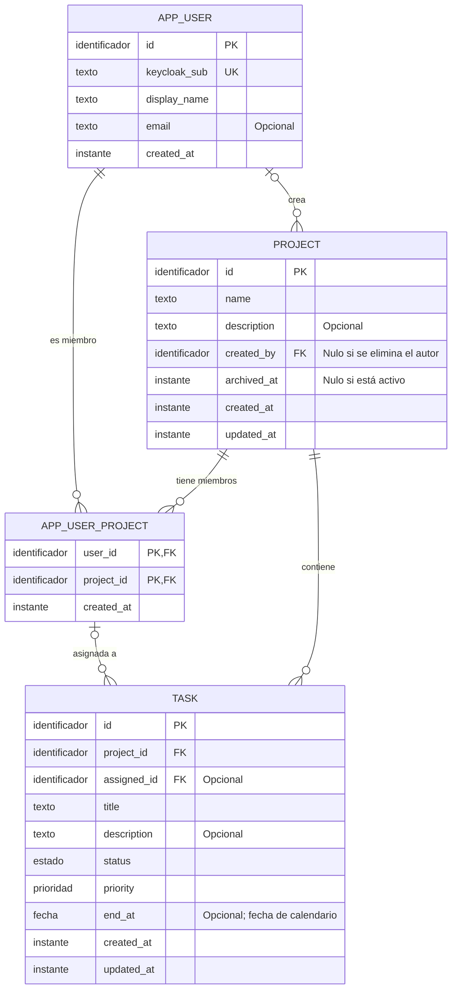

# TaskFlow — Modelo lógico de base de datos

> **Responsable:** David — backend
>
> **Estado:** borrador de fase 0; pendiente de revisión y de concretar el modelo físico
>
> **Última revisión:** 2026-10-22 — modelo con pertenencia a proyectos (`AppUser_Project`), roles `Admin`/`User` y eliminación de proyectos
>
> **Fuentes:** [requisitos funcionales](../02-requirements/functional-requirements.md) · [visión general del sistema §6](system-overview.md) · [ADR-0001](adr/0001-pertenencia-a-proyectos.md) · [ADR-0002](adr/0002-borrado-fisico.md)

## 1. Alcance y decisiones del análisis

Este documento desarrolla el esquema lógico de la base de datos de negocio de TaskFlow (PostgreSQL). La base de datos de Keycloak es independiente y no se describe aquí.

Los tipos indicados son conceptuales. Los tipos concretos de PostgreSQL, las longitudes y la representación física de estados y prioridades siguen pendientes (§7). **No hay tablas ni migraciones implementadas.**

Decisiones recogidas del análisis (propuestas, pendientes de aprobación del responsable técnico):

- La visibilidad de `User` se basa en la pertenencia a proyectos (`AppUser_Project`), que se adquiere al crear el proyecto o al recibir una tarea asignada ([ADR-0001](adr/0001-pertenencia-a-proyectos.md)).
- Una tarea solo puede asignarse a un miembro de su proyecto, y la base de datos lo garantiza con una clave foránea compuesta (§4).
- El borrado de tareas y de proyectos es **físico**; eliminar un proyecto elimina en cascada sus tareas y pertenencias ([ADR-0002](adr/0002-borrado-fisico.md)).
- Al eliminar un usuario local, sus tareas se conservan y quedan sin asignar (§5).
- `isOverdue` no se persiste: es un dato derivado del estado, del vencimiento y de la fecha actual de negocio (§6).

**Ajuste respecto al borrador anterior:** la eliminación de tareas ya no está limitada a `Admin`; cualquier miembro de un proyecto activo puede eliminar sus tareas (FR-012, BR-007). Ahora existe la eliminación de proyectos como funcionalidad, solo para `Admin` (FR-021).

## 2. Diagrama entidad-relación



**Leyenda:** `PK` es la clave primaria; `FK`, una clave foránea; `UK`, un valor único. `estado` y `prioridad` representan conjuntos cerrados de valores, no tipos concretos de PostgreSQL.

| Relación | Cardinalidad y regla |
|---|---|
| `AppUser` ↔ `Project` | N:M a través de `AppUser_Project`. Un usuario es miembro de cero o muchos proyectos; un proyecto tiene uno o más miembros (al menos su creador, mientras exista). |
| `Project` → `Task` | Un proyecto tiene cero o muchas tareas. Cada tarea pertenece exactamente a un proyecto y no puede cambiar de proyecto (BR-001). |
| `AppUser_Project` → `Task` | Una pertenencia tiene cero o muchas tareas asignadas. Cada tarea está sin asignar o asignada a un único miembro de su proyecto (BR-012). |
| `AppUser` → `Project` (`created_by`) | Dato de autoría. No determina la visibilidad: la da la fila de pertenencia del creador. |

No se incluye historial de asignaciones ni de cambios de estado.

## 3. Entidades y atributos

Convención propuesta: nombres de tablas y columnas en `snake_case` en PostgreSQL; las entidades de EF Core usan `PascalCase` (`Project.ArchivedAt` → `archived_at`). El nombre físico de las tablas (`app_user`, `project`, `app_user_project`, `task` o plural) se fijará con la primera migración.

### 3.1. AppUser

Referencia local a una identidad de Keycloak. No guarda contraseñas, tokens ni roles.

| Atributo | Tipo lógico | Obligatorio | Regla o significado |
|---|---|:---:|---|
| `id` | Identificador | Sí | Clave primaria local. |
| `keycloak_sub` | Texto | Sí | Valor `sub` del token. Único. No se asume que sea un UUID. |
| `display_name` | Texto | Sí | Nombre visible en listas de miembros y selector de asignados. |
| `email` | Texto | No | Correo de referencia. No es identificador ni se exige unicidad. |
| `created_at` | Instante | Sí | Alta del registro local, en UTC. |

`keycloak_sub` relaciona la identidad del token validado con el usuario local; no es una clave foránea a tablas internas de Keycloak. Si se admitieran varios emisores, la identidad externa sería la pareja emisor y sujeto.

Los usuarios de demostración se cargarán con su `sub` conocido (véase [authentication.md §6](authentication.md)). Crear la referencia solo en el primer inicio de sesión no basta para asignar tareas antes de ese acceso.

### 3.2. Project

| Atributo | Tipo lógico | Obligatorio | Regla o significado |
|---|---|:---:|---|
| `id` | Identificador | Sí | Clave primaria. |
| `name` | Texto | Sí | No vacío ni solo espacios (BR-002). Sin unicidad. |
| `description` | Texto | No | Descripción del proyecto. |
| `created_by` | Identificador | No* | FK a `AppUser.id`. La fija el backend con el usuario autenticado. *Obligatoria al crear; pasa a nula si se elimina el autor. |
| `archived_at` | Instante | No | `NULL` = activo. Con valor = archivado e instante del archivado. Restaurar la vuelve a `NULL`. |
| `created_at` | Instante | Sí | Creación en UTC, establecida por el backend. |
| `updated_at` | Instante | Sí | Última modificación en UTC; se inicializa con `created_at`. |

Se sustituye el antiguo indicador booleano `IsArchived` por `archived_at`, que conserva además la fecha que muestra la vista de archivados (FR-022).

### 3.3. AppUser_Project

Pertenencia de un usuario a un proyecto.

| Atributo | Tipo lógico | Obligatorio | Regla o significado |
|---|---|:---:|---|
| `user_id` | Identificador | Sí | FK a `AppUser.id`. Parte de la clave primaria. |
| `project_id` | Identificador | Sí | FK a `Project.id`. Parte de la clave primaria. |
| `created_at` | Instante | Sí | Momento en que el usuario pasó a ser miembro. |

La clave primaria compuesta (`user_id`, `project_id`) impide pertenencias duplicadas (BR-013). No hay columna de rol dentro del proyecto: los roles por proyecto están fuera del MVP.

### 3.4. Task

| Atributo | Tipo lógico | Obligatorio | Regla o significado |
|---|---|:---:|---|
| `id` | Identificador | Sí | Clave primaria. |
| `project_id` | Identificador | Sí | FK a `Project.id`. No se modifica tras la creación. |
| `assigned_id` | Identificador | No | Identifica al `AppUser` asignado. `NULL` = sin asignar. Junto con `project_id`, FK compuesta a `AppUser_Project`. |
| `title` | Texto | Sí | No vacío ni solo espacios (BR-002). |
| `description` | Texto | No | Descripción de la tarea. |
| `status` | Estado | Sí | `To Do`, `In Progress` o `Done` (BR-004). |
| `priority` | Prioridad | Sí | `Low`, `Medium` o `High` (BR-003). |
| `end_at` | Fecha | No | Fecha de vencimiento como fecha de calendario sin hora. |
| `created_at` | Instante | Sí | Creación en UTC. |
| `updated_at` | Instante | Sí | Última modificación en UTC, incluidos cambios de estado o asignación. |

`end_at` se mantiene como nombre propuesto, pero su tipo es una **fecha**, no un instante. Se recomienda renombrarla a `due_date` en la primera migración para evitar confusiones (§7).

No se añade `created_by` a `Task`, ya que los requisitos no lo exigen. La tarea no se asigna automáticamente a quien la crea.

## 4. Claves e integridad referencial

| Restricción | Definición propuesta | Comportamiento ante borrado |
|---|---|---|
| PK `app_user` | `id` | — |
| UK `app_user` | `keycloak_sub` | — |
| PK `project` | `id` | — |
| FK `project.created_by` | → `app_user(id)` | `ON DELETE SET NULL` |
| PK `app_user_project` | (`user_id`, `project_id`) | — |
| FK `app_user_project.user_id` | → `app_user(id)` | `ON DELETE CASCADE` |
| FK `app_user_project.project_id` | → `project(id)` | `ON DELETE CASCADE` |
| PK `task` | `id` | — |
| FK `task.project_id` | → `project(id)` | `ON DELETE CASCADE` |
| FK compuesta `task(project_id, assigned_id)` | → `app_user_project(project_id, user_id)` | `ON DELETE SET NULL (assigned_id)` |

**Clave compuesta de asignación.** Con la semántica `MATCH SIMPLE` predeterminada de PostgreSQL, la restricción no se evalúa si `assigned_id` es `NULL`, de modo que las tareas sin asignar no necesitan reglas adicionales. Cuando tiene valor, la pareja debe existir en `app_user_project`: es imposible asignar una tarea a quien no es miembro de su proyecto.

**`SET NULL` con lista de columnas.** Un `ON DELETE SET NULL` normal anularía también `project_id`, que es obligatorio. PostgreSQL 15 o posterior admite `ON DELETE SET NULL (assigned_id)`, que solo anula la columna indicada. Si la versión elegida en fase 0 no lo admite o EF Core no lo genera, la migración incluirá el SQL a mano o el caso de uso desasignará las tareas antes de borrar la pertenencia. Se verificará con una prueba de migración.

## 5. Operaciones y ciclo de vida

| Operación | Efecto en datos | Garantía |
|---|---|---|
| Crear proyecto | Inserta `project` (con `created_by`) y la pertenencia del creador. | Una única transacción. |
| Asignar tarea a un no miembro | Inserta la pertenencia si no existe y actualiza `assigned_id`. | Una transacción. Inserción idempotente (`INSERT … ON CONFLICT DO NOTHING`) para que dos asignaciones simultáneas no fallen ni dupliquen. |
| Desasignar o reasignar | Actualiza `assigned_id`. | La pertenencia anterior se conserva en el MVP. |
| Archivar proyecto | `archived_at = ahora (UTC)`. | No toca tareas ni pertenencias. |
| Restaurar proyecto | `archived_at = NULL`. | Los miembros vuelven a verlo. |
| Eliminar tarea | `DELETE` físico de la fila. | Sin `deleted_at`. No afecta a la pertenencia del asignado. |
| Eliminar proyecto | `DELETE` físico del proyecto; cascada a tareas y pertenencias. | Solo `Admin`. Se verificará en pruebas que la cascada simultánea sobre `task` y `app_user_project` termina sin violar la FK compuesta. |
| Eliminar usuario local | Cascada a sus pertenencias; sus tareas quedan sin asignar; `created_by` de sus proyectos pasa a `NULL`. | No es una operación del MVP; documenta la integridad si se ejecuta. |

Eliminar una identidad en Keycloak no borra la fila de `AppUser`: son almacenes independientes. Falta definir el tratamiento de identidades eliminadas o deshabilitadas en Keycloak (§7).

Las claves foráneas comprueban referencias y la pertenencia del asignado. Los permisos (quién puede hacer cada operación) y la exigencia de proyecto activo para `User` se comprueban en el backend; las acciones en cascada no comprueban roles.

## 6. Consultas, datos derivados e índices

### Visibilidad

Todas las consultas de `User` parten de su pertenencia y del estado del proyecto:

```text
proyectos visibles para el usuario U =
    project p
    unido a app_user_project m  (m.project_id = p.id y m.user_id = U)
    donde p.archived_at es NULL
```

Las tareas visibles son las de esos proyectos. `Admin` no aplica el filtro de pertenencia; las listas activas siguen exigiendo `archived_at IS NULL`.

### Vencimiento

`isOverdue` no es una columna ni un cuarto estado:

```text
isOverdue =
    end_at tiene valor
    y end_at < fecha actual de negocio
    y status != Done
```

Una tarea que vence hoy no está vencida. Una tarea sin vencimiento o completada tampoco lo está. Una tarea puede estar En curso y vencida a la vez. El frontend lo calcula para cada tarea mostrada con la fecha actual en `Europe/Madrid` ([frontend.md §5](frontend.md)).

### Indicadores

- Los recuentos del panel se calculan en la API con los datos persistidos y la misma visibilidad que las listas, sin tabla de contadores.
- Abiertas = `To Do` + `In Progress`; vencidas ⊂ abiertas.
- Se propone que la API calcule también el total de vencidas con la fecha de negocio, porque el frontend no dispone del conjunto completo si las listas se paginan; véase [api-contracts.md](../05-api/api-contracts.md).

### Índices previstos

| Índice | Uso |
|---|---|
| `app_user(keycloak_sub)` único | Resolver el usuario del token en cada solicitud. |
| PK `app_user_project(user_id, project_id)` | Proyectos de un usuario (visibilidad). |
| `app_user_project(project_id)` | Miembros de un proyecto. |
| `task(project_id, assigned_id)` | Soporta la FK compuesta y las tareas de un proyecto. |
| `task(assigned_id)` | «Mis tareas». |
| `project(archived_at)` o índice parcial `WHERE archived_at IS NULL` | Listas activas y vista de archivados. |

Se validarán con los planes de ejecución de las consultas reales; no se añadirán índices adicionales sin una consulta que los justifique.

## 7. Decisiones pendientes antes del modelo físico

| Decisión | Qué falta concretar |
|---|---|
| Identificadores | UUID o enteros para las claves locales, y su generación (base de datos o aplicación). |
| Textos | Longitudes máximas de `name`, `title`, `description`, `display_name` y tratamiento uniforme de opcionales vacíos. |
| Estados y prioridades | Representación física (texto con `CHECK`, enumerado de PostgreSQL o entero) y valores iniciales. |
| Fechas | Confirmar `end_at` como fecha sin hora y su posible renombrado a `due_date`. Zona horaria de negocio decidida: `Europe/Madrid`. |
| Versión de PostgreSQL | Confirmar soporte de `ON DELETE SET NULL (columna)` (PostgreSQL 15 o posterior) o la alternativa. |
| Usuarios | Preparación y actualización de referencias de demostración; identidades eliminadas o deshabilitadas en Keycloak. |
| Pertenencias | Si se retiran al quedarse sin tareas un usuario que no creó el proyecto (requisitos §8, cuestión 10). |
| Concurrencia | Ediciones simultáneas y uso de un token de concurrencia (p. ej. `xmin` de PostgreSQL con EF Core). |
| Migraciones | Esquema físico y su aplicación con migraciones de EF Core, incluidas pruebas desde base vacía. |

El modelo no añade organizaciones, comentarios, adjuntos ni historial de cambios. Los cambios de alcance se reflejarán en los requisitos funcionales y las decisiones arquitectónicas en los [ADR](adr/README.md).
