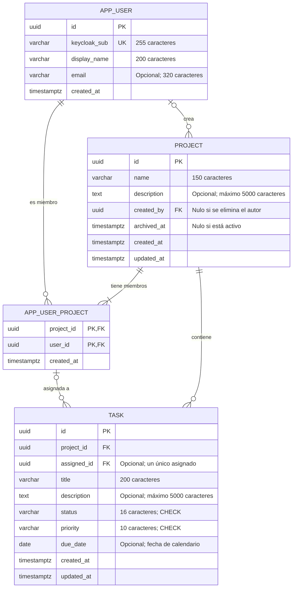

# TaskFlow — Modelo lógico y físico de base de datos

> **Responsable:** David — backend
>
> **Estado:** decisiones del modelo lógico y físico acordadas durante el análisis; pendientes de implementación y revisión de fase 0
>
> **Última revisión:** 2026-10-23 — modelo físico, perfil local, transacciones y protección del último miembro acordados
>
> **Coherencia:** se actualiza este documento del equipo. Los originales del manager se conservan hasta su aprobación; seguimiento en [documentation-alignment.md](documentation-alignment.md).
>
> **Fuentes:** [requisitos funcionales](../02-requirements/functional-requirements.md) · [visión general del sistema §6](system-overview.md) · [ADR-0001](adr/0001-pertenencia-a-proyectos.md) · [ADR-0002](adr/0002-borrado-fisico.md)

## 1. Alcance y decisiones del análisis

Este documento desarrolla el esquema lógico y físico de la base de datos de negocio de TaskFlow (PostgreSQL). La base de datos de Keycloak es independiente y no se describe aquí.

La base seleccionada es PostgreSQL 18.6, conforme a [backend.md §2](backend.md). Se acuerdan los tipos, longitudes y restricciones descritos a continuación. **No hay tablas ni migraciones implementadas.** Las cuestiones pendientes de implementación se recogen en §7.

Decisiones acordadas durante el análisis:

- La visibilidad de `User` se basa en la pertenencia a proyectos (`AppUser_Project`), que se adquiere al crear el proyecto o al recibir una tarea asignada ([ADR-0001](adr/0001-pertenencia-a-proyectos.md)).
- Una tarea solo puede asignarse a un miembro de su proyecto, y la base de datos lo garantiza con una clave foránea compuesta (§4).
- Cada tarea tiene **cero o un usuario asignado**; un usuario puede tener muchas tareas. Reasignar sustituye al anterior asignado, sin asignaciones simultáneas ni historial.
- El borrado de tareas y de proyectos es **físico**; eliminar un proyecto elimina en cascada sus tareas y pertenencias ([ADR-0002](adr/0002-borrado-fisico.md)).
- Se bloquea la eliminación de un usuario local si es el último miembro de algún proyecto, activo o archivado. Cuando se permite eliminarlo, sus tareas se conservan y quedan sin asignar (§5).
- `isOverdue` no se persiste: es un dato derivado del estado, del vencimiento y de la fecha actual de negocio (§6).

**Ajuste respecto al borrador anterior:** la eliminación de tareas ya no está limitada a `Admin`; cualquier miembro de un proyecto activo puede eliminar sus tareas (FR-012, BR-007). Ahora existe la eliminación de proyectos como funcionalidad, solo para `Admin` (FR-021).

## 2. Diagrama entidad-relación



**Leyenda:** `PK` es la clave primaria; `FK`, una clave foránea; `UK`, un valor único. Los tipos son de PostgreSQL; las longitudes, nulabilidad y restricciones se detallan en §3–4.

| Relación | Cardinalidad y regla |
|---|---|
| `AppUser` ↔ `Project` | N:M a través de `AppUser_Project`. Un usuario es miembro de cero o muchos proyectos; todo proyecto existente tiene uno o más miembros. Se bloquea la eliminación de un usuario si dejaría algún proyecto sin miembros. |
| `Project` → `Task` | Un proyecto tiene cero o muchas tareas. Cada tarea pertenece exactamente a un proyecto y no puede cambiar de proyecto (BR-001). |
| `AppUser_Project` → `Task` | Una pertenencia tiene cero o muchas tareas asignadas. Cada tarea está sin asignar o asignada a un único miembro de su proyecto (BR-012). |
| `AppUser` → `Project` (`created_by`) | Dato de autoría. No determina la visibilidad: la da la fila de pertenencia del creador. |

No se incluye historial de asignaciones ni de cambios de estado.

## 3. Entidades y atributos del modelo físico

Se acuerdan nombres de tablas en singular y columnas en `snake_case`: `app_user`, `project`, `app_user_project` y `task`. Las entidades de EF Core usan `PascalCase` (`Project.ArchivedAt` → `archived_at`).

Las claves locales son `uuid`, generadas por el backend al crear cada entidad; las claves foráneas usan el mismo tipo. No se exige generación de identificadores desde PostgreSQL. Los campos obligatorios se traducen a `NOT NULL`, salvo la excepción de `created_by` indicada en su tabla.

Los instantes usan `timestamptz` y se envían y generan en UTC; este tipo representa un instante, no conserva el nombre de una zona horaria. La fecha de vencimiento usa `date`. No se añade columna de versión para el MVP: se aplica última escritura gana, según [backend.md §6](backend.md).

### 3.1. AppUser

Referencia local a una identidad de Keycloak. No guarda contraseñas, tokens ni roles.

| Columna de `app_user` | Tipo PostgreSQL | Obligatoria | Regla o significado |
|---|---|:---:|---|
| `id` | `uuid` | Sí | Clave primaria local, generada por el backend. |
| `keycloak_sub` | `varchar(255)` | Sí | Valor `sub` del token. Único. Se trata como texto opaco, sin asumir UUID ni normalizar mayúsculas. |
| `display_name` | `varchar(200)` | Sí | Nombre visible en listas de miembros y selector de asignados. |
| `email` | `varchar(320)` | No | Correo de referencia. No es identificador ni se exige unicidad. |
| `created_at` | `timestamptz` | Sí | Alta del registro local, en UTC. |

`keycloak_sub` relaciona la identidad del token validado con el usuario local; no es una clave foránea a tablas internas de Keycloak. Si se admitieran varios emisores, la identidad externa sería la pareja emisor y sujeto.

Los usuarios de demostración se cargarán con su `sub` conocido (véase [authentication.md §6](authentication.md)). Crear la referencia solo en el primer inicio de sesión no basta para asignar tareas antes de ese acceso.

### 3.2. Project

| Columna de `project` | Tipo PostgreSQL | Obligatoria | Regla o significado |
|---|---|:---:|---|
| `id` | `uuid` | Sí | Clave primaria, generada por el backend. |
| `name` | `varchar(150)` | Sí | Entre 1 y 150 caracteres tras recortar espacios; no vacío ni solo espacios (BR-002). Sin unicidad. |
| `description` | `text` | No | Máximo 5.000 caracteres mediante `CHECK`. Vacío tras recortar → `NULL`. |
| `created_by` | `uuid` | No* | FK a `app_user.id`. La fija el backend con el usuario autenticado. *Obligatoria al crear; la columna admite `NULL` para conservar el proyecto si se elimina el autor. |
| `archived_at` | `timestamptz` | No | `NULL` = activo. Con valor = archivado e instante del archivado. Restaurar la vuelve a `NULL`. |
| `created_at` | `timestamptz` | Sí | Creación en UTC, establecida por el backend. |
| `updated_at` | `timestamptz` | Sí | Última modificación en UTC; se inicializa con `created_at`. |

Se sustituye el antiguo indicador booleano `IsArchived` por `archived_at`, que conserva además la fecha que muestra la vista de archivados (FR-022).

### 3.3. AppUser_Project

Pertenencia de un usuario a un proyecto.

| Columna de `app_user_project` | Tipo PostgreSQL | Obligatoria | Regla o significado |
|---|---|:---:|---|
| `project_id` | `uuid` | Sí | FK a `project.id`. Primer componente de la clave primaria. |
| `user_id` | `uuid` | Sí | FK a `app_user.id`. Segundo componente de la clave primaria. |
| `created_at` | `timestamptz` | Sí | Momento en que el usuario pasó a ser miembro, generado por el backend en UTC. |

La clave primaria compuesta (`project_id`, `user_id`) impide pertenencias duplicadas (BR-013). Este orden coincide con la referencia de asignación desde `task`. No hay columna de rol dentro del proyecto: los roles por proyecto están fuera del MVP.

### 3.4. Task

| Columna de `task` | Tipo PostgreSQL | Obligatoria | Regla o significado |
|---|---|:---:|---|
| `id` | `uuid` | Sí | Clave primaria, generada por el backend. |
| `project_id` | `uuid` | Sí | FK a `project.id`. No se modifica tras la creación. |
| `assigned_id` | `uuid` | No | Un único usuario asignado. `NULL` = sin asignar. Junto con `project_id`, FK compuesta a `app_user_project`. |
| `title` | `varchar(200)` | Sí | Entre 1 y 200 caracteres tras recortar espacios; no vacío ni solo espacios (BR-002). Sin unicidad. |
| `description` | `text` | No | Máximo 5.000 caracteres mediante `CHECK`. Vacío tras recortar → `NULL`. |
| `status` | `varchar(16)` | Sí | `CHECK` con `ToDo`, `InProgress` o `Done`. Predeterminado `ToDo` al omitirse en creación; `NULL` no admitido. |
| `priority` | `varchar(10)` | Sí | `CHECK` con `Low`, `Medium` o `High`. Obligatoria, sin valor predeterminado. |
| `due_date` | `date` | No | Fecha de vencimiento sin hora. Se permiten fechas pasadas. |
| `created_at` | `timestamptz` | Sí | Creación en UTC, establecida por el backend. |
| `updated_at` | `timestamptz` | Sí | Última modificación en UTC, incluidos cambios de estado o asignación; se inicializa con `created_at`. |

Se acuerda `due_date` como nombre físico, en lugar del anterior `end_at`, para expresar que es una **fecha**, no un instante. En la API se mantiene `dueDate`; el contrato usa el mismo nombre físico. Las referencias antiguas en la visión general original se conservan hasta su revisión por el manager.

Solo hay una columna `assigned_id`, por lo que una tarea no puede tener dos responsables simultáneos. No se crea una tabla intermedia tarea-usuario. Si se permite borrar a su asignado, esa columna pasa a `NULL` y la tarea conserva su proyecto; podrá asignarse después a otra persona.

No se añade `created_by` a `Task`, ya que los requisitos no lo exigen. La tarea no se asigna automáticamente a quien la crea.

## 4. Claves e integridad referencial

| Restricción | Definición acordada | Comportamiento ante borrado |
|---|---|---|
| PK `app_user` | `id` | — |
| UK `app_user` | `keycloak_sub` | — |
| PK `project` | `id` | — |
| FK `project.created_by` | → `app_user(id)` | `ON DELETE SET NULL` |
| PK `app_user_project` | (`project_id`, `user_id`) | — |
| FK `app_user_project.user_id` | → `app_user(id)` | `ON DELETE CASCADE` |
| FK `app_user_project.project_id` | → `project(id)` | `ON DELETE CASCADE` |
| PK `task` | `id` | — |
| FK `task.project_id` | → `project(id)` | `ON DELETE CASCADE` |
| FK compuesta `task(project_id, assigned_id)` | → `app_user_project(project_id, user_id)` | `ON DELETE SET NULL (assigned_id)` |

**Clave compuesta de asignación.** Con la semántica `MATCH SIMPLE` predeterminada de PostgreSQL, la restricción no se evalúa si `assigned_id` es `NULL`, de modo que las tareas sin asignar no necesitan reglas adicionales. Cuando tiene valor, la pareja debe existir en `app_user_project`: es imposible asignar una tarea a quien no es miembro de su proyecto.

**`SET NULL` con lista de columnas.** Un `ON DELETE SET NULL` normal anularía también `project_id`, que es obligatorio. PostgreSQL 18.6 admite `ON DELETE SET NULL (assigned_id)`, que solo anula la columna indicada. La migración usará SQL explícito si EF Core no genera esta cláusula. Se verificará con una prueba de migración, incluido el borrado de un proyecto con tareas asignadas.

**Restricciones de contenido.** Además de `NOT NULL` y las longitudes `varchar`, se añadirán `CHECK` para impedir nombres y títulos vacíos o solo espacios, limitar las descripciones a 5.000 caracteres y restringir `status` y `priority` a los códigos exactos de §3.4. No se exigen nombres de proyecto ni títulos únicos. El backend normaliza los textos antes de validar y guardar, según [backend.md §8](backend.md).

## 5. Operaciones y ciclo de vida

| Operación | Efecto en datos | Garantía |
|---|---|---|
| Crear proyecto | Inserta `project` (con `created_by`) y la pertenencia del creador. | Una única transacción. |
| Asignar tarea a un no miembro | Inserta la pertenencia si no existe y actualiza `assigned_id`. | Una transacción. Inserción idempotente (`INSERT … ON CONFLICT DO NOTHING`) para que dos asignaciones simultáneas no fallen ni dupliquen. |
| Desasignar o reasignar | Actualiza `assigned_id`. | La pertenencia anterior se conserva en el MVP. |
| Archivar proyecto | `archived_at = ahora (UTC)`. | No toca tareas ni pertenencias. |
| Restaurar proyecto | `archived_at = NULL`. | Los miembros vuelven a verlo. |
| Eliminar tarea | `DELETE` físico de la fila. | Sin `deleted_at`. No afecta a la pertenencia del asignado. |
| Eliminar proyecto | `DELETE` físico del proyecto; cascada a tareas y pertenencias. | Solo `Admin`, tanto activo como archivado. Puede eliminarse aunque tenga un único miembro: el mínimo de miembros no bloquea el borrado del propio proyecto. Se verificará la cascada con tareas asignadas. |
| Eliminar usuario local | Si es el último miembro de algún proyecto, se rechaza toda la operación y se informa de que no puede eliminarse hasta incorporar otro miembro. En otro caso, se eliminan sus pertenencias, sus tareas quedan sin asignar y `created_by` de sus proyectos pasa a `NULL`. | No se añade un endpoint al MVP. El procedimiento de borrado local debe garantizar la comprobación y los cambios de forma atómica, también ante borrados concurrentes. |

La comprobación del último miembro se aplica a todos los proyectos existentes del usuario, incluidos los archivados. Si alguno quedaría sin miembros, no se elimina el usuario ni se modifica ninguna de sus tareas, autorías o pertenencias. Primero deberá incorporarse otro miembro por un mecanismo permitido y después repetirse la eliminación.

Las claves foráneas y sus cascadas no garantizan por sí solas el mínimo de un miembro. Se acuerda un procedimiento de mantenimiento: bloquear primero el usuario, después sus proyectos en orden por UUID, volver a contar sus miembros tras los bloqueos y rechazar toda la operación si alguno quedaría sin miembros. Las nuevas relaciones protegen antes la identidad referenciada y siguen el mismo orden de bloqueos. La eliminación del propio proyecto sigue permitida con un solo miembro.

Las escrituras de proyectos, tareas y pertenencias usarán transacciones cortas `Read Committed` con bloqueo de fila del proyecto antes de volver a comprobar visibilidad, estado y permisos. El detalle y los resultados de carreras están en [backend.md §6](backend.md). No se añade versión de edición ni un bloqueo que dure mientras se rellena el formulario.

No hay endpoint de borrado de usuarios: se admite mediante el procedimiento controlado. La cuenta habitual de API no borrará usuarios ni retirará pertenencias manualmente; las cascadas del proyecto siguen permitidas. Un `DELETE` privilegiado fuera del procedimiento no queda protegido por esta comprobación.

Eliminar o deshabilitar una identidad en Keycloak conserva `AppUser`, pertenencias, autorías y tareas. Se acepta para el MVP que la referencia pueda seguir apareciendo en asignables, porque no se sincroniza su actividad. El borrado local sigue siendo una operación independiente con las reglas anteriores.

El perfil se crea al primer acceso y se sincroniza desde el token validado al consultar `/me`, después del login y de renovar el token. El nombre prefiere `name`, después `preferred_username` y finalmente `Usuario` más parte del UUID; se limita la copia visible a 200 caracteres. Un correo ausente, inválido o demasiado largo queda a `NULL`. Las reglas completas están en [authentication.md §6](authentication.md). No se guardan roles.

Las claves foráneas comprueban referencias y la pertenencia del asignado. Los permisos (quién puede hacer cada operación) y la exigencia de proyecto activo para `User` se comprueban en el backend; las acciones en cascada no comprueban roles.

## 6. Consultas, datos derivados e índices

### Visibilidad

Todas las consultas de `User` parten de su pertenencia y del estado del proyecto:

```text
proyectos visibles para el usuario U =
    project p
    unido a app_user_project m  (m.project_id = p.id y m.user_id = U)
    donde p.archived_at es NULL
```

Las tareas visibles son las de esos proyectos. `Admin` no aplica el filtro de pertenencia; las listas activas siguen exigiendo `archived_at IS NULL`.

### Vencimiento

`isOverdue` no es una columna ni un cuarto estado:

```text
isOverdue =
    due_date tiene valor
    y due_date < fecha actual de negocio
    y status != Done
```

Una tarea que vence hoy no está vencida. Una tarea sin vencimiento o completada tampoco lo está. Una tarea puede estar En curso y vencida a la vez. El frontend lo calcula para cada tarea mostrada con la fecha actual en `Europe/Madrid` ([frontend.md §5](frontend.md)).

### Indicadores

- Los recuentos del panel se calculan en la API con los datos persistidos y la misma visibilidad que las listas, sin tabla de contadores.
- Abiertas = `ToDo` + `InProgress`; vencidas ⊂ abiertas.
- La API calcula también el total de vencidas con la fecha de negocio, porque el frontend no dispone del conjunto completo si las listas se paginan; véanse [backend.md §8](backend.md) y [api-contracts.md](../05-api/api-contracts.md).

### Índices previstos

| Índice | Uso |
|---|---|
| `app_user(keycloak_sub)` único | Resolver el usuario del token en cada solicitud. |
| PK `app_user_project(project_id, user_id)` | Miembros de un proyecto y clave referenciada por la asignación. |
| `app_user_project(user_id, project_id)` | Proyectos de un usuario (visibilidad). |
| `task(project_id, assigned_id)` | Soporta la FK compuesta y las tareas de un proyecto. |
| `task(assigned_id)` | «Mis tareas». |
| `project(archived_at)` o índice parcial `WHERE archived_at IS NULL` | Listas activas y vista de archivados. |

Los índices de claves primarias y de unicidad ya los crea PostgreSQL; no se duplicarán con índices manuales equivalentes. La elección entre índice completo o parcial de archivado se concretará al revisar las consultas reales. Se validarán los planes de ejecución; no se añadirán índices adicionales sin una consulta que los justifique.

## 7. Cuestiones pendientes de implementación

| Decisión | Qué falta concretar |
|---|---|
| Mapeo y primera migración | Implementar los tipos, longitudes, nulabilidad, claves, restricciones e índices acordados. Verificar el SQL generado y añadir explícitamente el `SET NULL` parcial si hace falta. |
| Usuarios | Implementar los acuerdos de perfil y conservación de referencias de §5 y preparar los datos de demostración; las decisiones sobre claims y cuentas inactivas ya están tomadas. |
| Protección del último miembro | Implementar y probar el procedimiento transaccional acordado en §5, sin bloquear la eliminación del propio proyecto. |
| Concurrencia entre operaciones | Implementar transacciones cortas y bloqueos por proyecto, y verificar carreras de archivado/modificación y eliminación/asignación según [backend.md §6](backend.md). Última escritura gana sigue vigente para las ediciones. |
| Consultas e índices | Comprobar los planes de las consultas reales y concretar el índice de archivado. |
| Ejecución y verificación de migraciones | Decidido: aplicarlas en un paso separado en desarrollo, sin ejecutarlas desde el arranque de la API, según [backend.md §10](backend.md). Falta implementar y documentar el procedimiento y probar la reconstrucción desde una base vacía. El despliegue se definirá al preparar ese entorno. |

La pertenencia se conserva al desasignar, reasignar o eliminar tareas; no se retira automáticamente en el MVP. La detección de conflictos entre ediciones se recoge como mejora futura en el [backlog](../backlog.md), sin añadir ahora una columna de versión ni usar `xmin` como token de concurrencia.

La guía de [entorno local](../04-development/environment-setup.md) recoge la orquestación con Aspire y la ejecución explícita de migraciones. Estas migraciones solo afectan a la base de negocio; no modifican tablas internas de Keycloak.

El modelo no añade organizaciones, comentarios, adjuntos ni historial de cambios. Los cambios de alcance se reflejarán en los requisitos funcionales y las decisiones arquitectónicas en los [ADR](adr/README.md).
