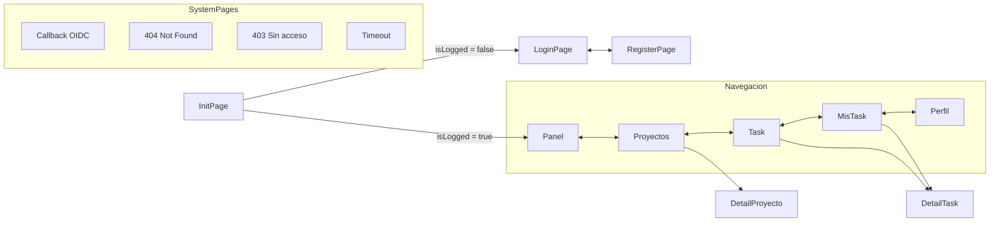

# TaskFlow — Arquitectura del frontend

> **Responsable:** Oliver — frontend
>
> **Contenido:** estructura de la aplicación, navegación, consultas y recorridos de usuario
>
> **Estado:** borrador de fase 0; propuesta pendiente de revisión. No hay código de frontend implementado.
>
> **Última revisión:** 2026-10-22 — registro mediante Keycloak, Archivados como popup, zona horaria `Europe/Madrid`, paginación, mensajes en `es-ES`, Bruno para comprobar la API
>
> **Fuentes:** [requisitos funcionales](../02-requirements/functional-requirements.md) · [visión general del sistema §3](system-overview.md) · [autenticación](authentication.md) · [contrato de API](../05-api/api-contracts.md)

## 1. Alcance

Este documento describe cómo se organizará la SPA de TaskFlow (React + TypeScript + Vite, TanStack Router, TanStack Query, Tailwind CSS y shadcn/ui): páginas y navegación, protección de rutas por sesión y rol, consultas a la API y su invalidación, cálculo de tareas vencidas, y cómo se recorren los escenarios de aceptación A–E.

Principios:

- La SPA **no decide permisos**: oculta o desactiva controles según el rol para ayudar al usuario, pero la API vuelve a comprobarlo todo (401/403/404).
- Los tokens viven **solo en memoria**; nunca en `localStorage` ni `sessionStorage`.
- El estado que procede de la API lo gestiona TanStack Query; el estado de formularios y de presentación vive en el componente que lo usa.
- Las etiquetas visibles están en español; los valores técnicos (`ToDo`, `High`…) solo se usan en el código y en la API.

## 2. Estructura de la aplicación

Propuesta de carpetas, alineada con la [visión general §3](system-overview.md). Los nombres son orientativos hasta que exista el proyecto.

```text
frontend/
├── index.html
├── vite.config.ts
├── .env.example                # solo variables públicas VITE_*
└── src/
    ├── main.tsx                # arranque: inicializa la sesión y monta los proveedores
    ├── app/
    │   ├── providers.tsx       # AuthProvider, QueryClientProvider, RouterProvider
    │   ├── router.tsx          # árbol de rutas de TanStack Router
    │   └── layouts/
    │       ├── PublicLayout.tsx    # LoginPage, páginas de sistema
    │       └── AppLayout.tsx       # cabecera, menú de navegación, usuario y cierre de sesión
    ├── features/
    │   ├── auth/               # InitPage, LoginPage, CallbackPage, hook useSession
    │   ├── dashboard/          # Panel e indicadores
    │   ├── projects/           # Proyectos, DetailProyecto, popups de proyecto y Archivados
    │   ├── tasks/              # Task, DetailTask, popups de tarea, filtros
    │   ├── my-tasks/           # MisTask
    │   ├── profile/            # Perfil
    │   └── system/             # 403, 404, Timeout
    ├── components/
    │   ├── ui/                 # componentes de shadcn/ui
    │   └── common/             # ConfirmDialog, EmptyState, ErrorState, Loading, badges de estado/prioridad
    └── lib/
        ├── api/                # cliente HTTP tipado, tipos del contrato, mapeo de errores Problem Details
        ├── auth/               # integración con Keycloak (keycloak-js u otra biblioteca OIDC aprobada)
        ├── query-keys.ts       # claves de consulta centralizadas
        ├── dates.ts            # fecha de negocio e isOverdue
        └── config.ts           # lectura de variables VITE_* públicas
```

Cada carpeta de `features/` agrupa sus pantallas, formularios, hooks de consulta (`useProjects`, `useCreateTask`…) y pruebas.

**Configuración pública** (`.env.example`, todo lo que se incluye en el bundle es público):

| Variable | Uso |
|---|---|
| `VITE_API_BASE_URL` | URL base de la API |
| `VITE_KEYCLOAK_URL` | URL pública de Keycloak |
| `VITE_KEYCLOAK_REALM` | Realm |
| `VITE_KEYCLOAK_CLIENT_ID` | Cliente público de la SPA |

Ningún secreto puede ir en estas variables.

## 3. Mapa de páginas

### 3.1. Flujo inicial

- **InitPage** → comprueba `isLogged`
  - `false` → **LoginPage**
  - `true` → **Panel** (zona de navegación)

`isLogged` es el resultado de inicializar el adaptador OIDC en modo de comprobación silenciosa de sesión (`check-sso`) con PKCE `S256`. Si Keycloak ya tiene sesión, la SPA obtiene tokens sin pedir credenciales; si no, va a LoginPage. Al llegar a una ruta protegida sin sesión se guarda la ruta original para volver a ella tras el inicio de sesión.

### 3.2. Autenticación (no logueado)

- **LoginPage** ⇄ **RegisterPage**

TaskFlow no gestiona contraseñas (FR-001). Ni LoginPage ni RegisterPage tienen formularios de credenciales: **la SPA solo muestra la pantalla y redirige a Keycloak**, que es quien autentica y registra.

- **LoginPage:** presentación de la aplicación, botón «Iniciar sesión» (redirige al inicio de sesión de Keycloak) y enlace a RegisterPage.
- **RegisterPage:** explicación breve y botón «Crear cuenta», que redirige a la pantalla de **registro de Keycloak** (`keycloak.register()` en `keycloak-js`). Tras registrarse, Keycloak devuelve al usuario a Callback ya autenticado. Enlace de vuelta a LoginPage.

Lo que esto exige fuera del frontend ([authentication.md](authentication.md)):

- Registro de usuarios habilitado en el realm de Keycloak.
- El rol `User` como rol por defecto de los usuarios nuevos; `Admin` nunca se obtiene por registro.
- La API crea el `AppUser` en la primera solicitud de un usuario autenticado que aún no lo tenga. Un usuario recién registrado no ve ningún proyecto hasta que crea uno o le asignan una tarea.

### 3.3. Navegación (logueado)

| Página      | Detalle            |
|-------------|--------------------|
| Panel       | —                  |
| Proyectos   | → DetailProyecto   |
| Task        | → DetailTask       |
| MisTask     | → DetailTask       |
| Perfil      | —                  |

> Las páginas principales de navegación están conectadas entre sí mediante el menú de `AppLayout`.

| Página | Contenido | Requisitos |
|---|---|---|
| **Panel** | Proyectos activos y tareas abiertas, completadas y vencidas (globales para `Admin`, de sus proyectos para `User`) | FR-017 |
| **Proyectos** | Lista de proyectos visibles con nombre y descripción; botón «Nuevo proyecto»; para `Admin`, acceso a «Archivados» | FR-004, FR-006, FR-022 |
| **DetailProyecto** | Datos del proyecto, miembros y tareas del proyecto con filtros; acciones según rol (editar; archivar y eliminar solo `Admin`) | FR-005, FR-007, FR-008, FR-021, FR-023 |
| **Task** | Todas las tareas visibles con filtros por proyecto, estado, prioridad y asignado, y ordenación | FR-010, FR-015 |
| **DetailTask** | Datos completos de la tarea; cambio de estado, asignación, edición y eliminación | FR-010 a FR-014 |
| **MisTask** | Tareas asignadas al usuario actual en proyectos activos | FR-016 |
| **Perfil** | Nombre, correo y rol del usuario actual; botón de cierre de sesión | FR-002, FR-003 |

### 3.4. System Pages

- **Callback** (OIDC, recibe el código de autorización)
- **404** Not Found
- **403** Sin acceso
- **Timeout**

| Página | Cuándo se muestra |
|---|---|
| **Callback** | URL de retorno registrada en Keycloak, tanto tras iniciar sesión como tras registrarse. Completa el intercambio del código y redirige a la ruta guardada o al Panel. Si falla, muestra error y permite reintentar. |
| **404** | Ruta inexistente, o la API responde 404 al cargar un proyecto o tarea. Mismo mensaje para «no existe» y «no visible» (no se revela la existencia). |
| **403** | Token válido sin rol admitido, o acceso a una ruta solo para `Admin`. |
| **Timeout** | La sesión ha caducado y la renovación silenciosa falla. Se borran tokens y caché y se ofrece volver a iniciar sesión (FR-002). |

Los 403 de una **acción** concreta (p. ej. un `User` intentando archivar desde una llamada directa) no cambian de página: se muestran como aviso en la pantalla actual.

### 3.5. Popups

- NuevoProyecto
- EditarProyecto
- NuevaTarea
- EditarTarea
- Archivados

| Popup | Quién | Qué hace | Requisitos |
|---|---|---|---|
| **NuevoProyecto** | `Admin`, `User` | Nombre (obligatorio) y descripción. Al crear, navega a DetailProyecto | FR-006 |
| **EditarProyecto** | `Admin`; `User` miembro | Edita nombre y descripción | FR-007 |
| **NuevaTarea** | `Admin`; `User` miembro | Título, descripción, prioridad, estado (por defecto Pendiente), vencimiento y asignado opcional | FR-009, FR-013 |
| **EditarTarea** | `Admin`; `User` miembro | Título, descripción, prioridad y vencimiento. Estado y asignación se cambian desde DetailTask, cada uno con su operación | FR-011 |
| **Archivados** | Solo `Admin` | Popup (no tiene ruta propia) abierto desde Proyectos. Lista paginada de proyectos archivados con fecha de archivado; abrir (navega a DetailProyecto, marcado como archivado), restaurar o eliminar | FR-022, FR-021 |
| **Confirmación** (genérico) | Según acción | Archivar, restaurar, eliminar proyecto (advierte que se borran sus tareas) y eliminar tarea | FR-008, FR-012, FR-021, FR-022 |

Al asignar una tarea a alguien que no es miembro, el selector avisa de que esa persona pasará a ver el proyecto (FR-023).

### 3.6. Diagrama



### 3.7. Rutas propuestas (TanStack Router)

| Ruta | Página | Protección |
|---|---|---|
| `/` | InitPage | Pública |
| `/login` | LoginPage | Pública |
| `/registro` | RegisterPage | Pública |
| `/callback` | Callback | Pública |
| `/panel` | Panel | Sesión |
| `/proyectos` | Proyectos | Sesión |
| `/proyectos/$projectId` | DetailProyecto | Sesión (la API decide la visibilidad) |
| `/tareas` | Task | Sesión |
| `/tareas/$taskId` | DetailTask | Sesión |
| `/mis-tareas` | MisTask | Sesión |
| `/perfil` | Perfil | Sesión |
| `/403`, `/sesion-expirada` | 403, Timeout | Pública |
| `*` | 404 | Pública |

- La protección de **sesión** se hace en un `beforeLoad` de la rama protegida: sin sesión, redirige a `/login` guardando la ruta.
- La protección por **rol** solo mejora la experiencia (redirige a `/403`); la seguridad real está en la API.
- Los filtros, la ordenación y la página de las listas viven en los **parámetros de búsqueda** de la URL (`?status=ToDo&sort=dueDate&page=2`), validados con el esquema de búsqueda de la ruta. Así se pueden compartir enlaces y recargar sin perderlos. Cambiar un filtro o la ordenación vuelve a la página 1.

### 3.8. Controles según el rol

| Control | `Admin` | `User` |
|---|---|---|
| Nuevo proyecto | Sí | Sí |
| Editar proyecto | Sí | Si es miembro (todo proyecto visible lo es) |
| Archivar / eliminar proyecto | Sí | Oculto |
| Acceso a Archivados | Sí | Oculto |
| Nueva tarea, editar, eliminar, asignar, cambiar estado | Sí | Sí, en sus proyectos visibles |
| Panel | Recuentos globales | Recuentos de sus proyectos |

El rol se obtiene de `GET /api/v1/me`.

## 4. Consultas y estado del servidor (TanStack Query)

### 4.1. Cliente HTTP

`lib/api` expone funciones tipadas según el [contrato](../05-api/api-contracts.md):

- Añade `Authorization: Bearer <access token>` y, si el token está a punto de caducar, lo renueva antes de enviar.
- Convierte las respuestas de error (Problem Details) en un error tipado con `status` y, en los 400, `errors` por campo.
- Mientras el backend no esté listo, se pueden usar **simulaciones tipadas** del contrato, que se retiran antes de la entrega.

### 4.2. Claves y consultas

| Clave | Endpoint | Pantallas |
|---|---|---|
| `['me']` | `GET /api/v1/me` | AppLayout, Perfil, controles por rol |
| `['dashboard']` | `GET /api/v1/dashboard` | Panel; también aporta la fecha de negocio |
| `['projects', { archived, page }]` | `GET /api/v1/projects` | Proyectos, popup Archivados |
| `['projects', projectId]` | `GET /api/v1/projects/{id}` | DetailProyecto |
| `['tasks', { filtros, sort, page }]` | `GET /api/v1/tasks` | Task, tareas de DetailProyecto |
| `['tasks', taskId]` | `GET /api/v1/tasks/{id}` | DetailTask |
| `['my-tasks', { filtros, sort, page }]` | `GET /api/v1/me/tasks` | MisTask |
| `['users', 'assignable']` | `GET /api/v1/users/assignable` | Selector de asignado |

**Paginación.** Las listas de proyectos y tareas están paginadas ([contrato §6](../05-api/api-contracts.md)). Se usa `placeholderData: keepPreviousData` para que la tabla no parpadee al cambiar de página, y la interfaz muestra el total (`totalCount`) y los controles de página. Si tras eliminar el último elemento de una página esta queda vacía, se vuelve a la anterior.

### 4.3. Invalidación tras mutaciones

| Mutación | Invalida |
|---|---|
| Crear o editar proyecto | `['projects']`, `['dashboard']` |
| Archivar, restaurar o eliminar proyecto | `['projects']`, `['tasks']`, `['my-tasks']`, `['dashboard']` |
| Crear, editar o eliminar tarea | `['tasks']`, `['my-tasks']`, `['dashboard']` |
| Cambiar estado | `['tasks']`, `['my-tasks']`, `['dashboard']` |
| Asignar o desasignar | `['tasks']`, `['my-tasks']`, `['projects', projectId]` (miembros), `['dashboard']` |

Para el cambio de estado se puede aplicar una actualización optimista con reversión si la API falla. El resto de mutaciones espera la respuesta para evitar mostrar datos que el servidor ha rechazado.

### 4.4. Errores y sesión

| Respuesta | Comportamiento |
|---|---|
| 400 | Mostrar los errores en los campos del formulario |
| 401 | Intentar renovar el token una vez; si falla, ir a Timeout |
| 403 | Aviso en la pantalla actual; si es por falta de rol, ir a `/403` |
| 404 | Al cargar un detalle, página 404; tras una mutación, aviso y volver a la lista |
| 5xx / red | Mensaje genérico con opción de reintentar, sin detalles técnicos (FR-018) |

Los 4xx no se reintentan automáticamente; los errores de red sí, con pocos reintentos. Al **cerrar sesión** o caducar la sesión se ejecuta `queryClient.clear()` además de borrar los tokens (FR-002).

## 5. Tareas vencidas y zona horaria

**Cálculo.** `isOverdue` no lo envía la API: se calcula en `lib/dates.ts` para cada tarea ([database.md §6](database.md)):

```text
isOverdue = dueDate tiene valor y dueDate < fechaDeNegocio y status != Done
```

- `dueDate` es una fecha de calendario (`YYYY-MM-DD`): se compara como texto o como fecha sin hora, **nunca** convirtiéndola a un instante con la zona del navegador.
- `fechaDeNegocio` es la fecha actual en la zona horaria de negocio **`Europe/Madrid`**, independientemente de la zona del navegador del usuario (p. ej. con `Intl.DateTimeFormat('sv-SE', { timeZone: 'Europe/Madrid' })`, que devuelve `YYYY-MM-DD`). Coincide con la `businessDate` que devuelve `GET /api/v1/dashboard`.
- Los instantes (`createdAt`, `updatedAt`, `archivedAt`) llegan en UTC y se muestran convertidos a `Europe/Madrid` con formato `es-ES`.

## 6. Formularios y estados de la interfaz

- Validación en el cliente con las mismas reglas que la API (nombre y título obligatorios y no vacíos; valores de estado y prioridad cerrados); la API sigue siendo la autoridad y sus errores 400 se muestran en los campos tal como llegan, porque la API ya los devuelve en español (`es-ES`).
- Toda la interfaz está en `es-ES`: textos, fechas (`dd/mm/aaaa`) y números.
- Botones de envío desactivados mientras la mutación está en curso, para evitar envíos duplicados.
- Estados claros en todas las listas: carga, vacío (con acción sugerida, p. ej. «Crea tu primer proyecto») y error.
- Confirmación obligatoria antes de archivar, restaurar, eliminar proyecto y eliminar tarea.
- Mensajes de éxito o error tras cada operación (FR-018).
- Etiquetas: `ToDo` → «Pendiente», `InProgress` → «En curso», `Done` → «Completada»; `Low` → «Baja», `Medium` → «Media», `High` → «Alta».

## 7. Recorridos de usuario

Correspondencia de los recorridos de aceptación ([requisitos §6](../02-requirements/functional-requirements.md)) con las pantallas:

| Recorrido | Pasos en la interfaz |
|---|---|
| **A** — `User` crea y asigna | Login → Panel → Proyectos → NuevoProyecto «Rediseño del sitio web» → DetailProyecto → NuevaTarea «Construir la página de inicio» (Alta, Pendiente) → asignar a «Usuario B» con vencimiento futuro → ver a «Usuario B» en miembros → recargar |
| **B** — `User` asignado colabora | Login como «Usuario B» → Proyectos (aparece el proyecto) → MisTask → DetailTask → En curso → Completada → NuevaTarea sin asignar → EditarTarea (prioridad) → Panel. Los botones de archivar y eliminar no aparecen; una llamada directa recibe 403 |
| **C** — Visibilidad y validación | Login como «Usuario C» → el proyecto no aparece en Proyectos ni cuenta en el Panel → abrir su URL → 404 → NuevoProyecto con nombre vacío → error en el campo → URL de proyecto inexistente → 404 |
| **D** — AWS | Recorridos A, B, C y E en la URL HTTPS desplegada |
| **E** — `Admin` | Login como «Admin» → Panel global → Proyectos → DetailProyecto → Archivar (confirmación) → como «Usuario A»/«Usuario B», el proyecto ya no aparece → como «Admin», Archivados → Restaurar → crear proyecto de prueba → Eliminar (confirmación) |

## 8. Pruebas

- **Vitest + React Testing Library** para componentes y hooks: formularios y validación, estados de carga/vacío/error, controles por rol, paginación, cálculo de `isOverdue` (límites de fecha en `Europe/Madrid`: hoy, ayer, sin fecha, completada, navegador en otra zona) y limpieza de caché al cerrar sesión.
- **Bruno** para comprobar la API: una colección versionada en el repositorio con las peticiones del contrato y un entorno por despliegue (local, AWS) sin secretos. Sirve para verificar los endpoints antes de integrarlos en la interfaz y para reproducir errores.
- Los recorridos completos se validan contra la API real en local y en AWS; una pantalla con datos simulados no completa un requisito.

## 9. Decisiones pendientes

### Decididas (2026-10-22)

| Decisión | Resultado |
|---|---|
| RegisterPage | Se mantiene; solo frontend, redirige al registro de Keycloak (§3.2) |
| Archivados | Popup, sin ruta propia |
| Zona horaria de negocio | `Europe/Madrid`; instantes almacenados en UTC |
| Paginación de listas | Sí ([contrato §6](../05-api/api-contracts.md)) |
| Idioma de la interfaz y de los mensajes de validación | `es-ES` |
| Comprobación de la API | Bruno |

### Pendientes

| Decisión | Propuesta actual |
|---|---|
| Biblioteca OIDC | `keycloak-js` (adaptador oficial de Keycloak): soporta PKCE, `check-sso`, registro, renovación y cierre de sesión |
| Simulación de la API en pruebas unitarias de componentes | Pendiente |
