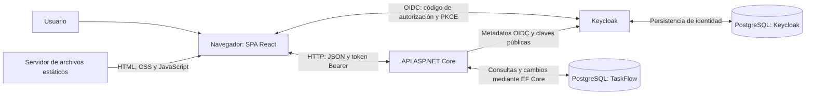

# TaskFlow — Visión general del sistema

> **Estado:** propuesta inicial pendiente de revisión y aprobación
>
> **Fase:** 0 — análisis y diseño
>
> **Responsables:** desarrolladores de backend y frontend; revisión del responsable técnico
>
> **Alcance:** MVP definido en los [requisitos funcionales](../02-requirements/functional-requirements.md)

## 1. Propósito y estado real

Este documento propone la arquitectura de TaskFlow, una aplicación web de gestión de proyectos y tareas para el programa de incorporación técnica. Describe responsabilidades, comunicaciones, seguridad, persistencia y organización prevista del repositorio.

**Actualmente solo existen el README y la documentación de planificación.** Todavía no hay código de backend o frontend, manifiestos de infraestructura, migraciones, pruebas ni flujos de CI. Las carpetas, componentes y decisiones que se proponen a continuación no deben interpretarse como funcionalidades implementadas o como una arquitectura ya aprobada.

La fase 0 debe cerrar las decisiones pendientes de la sección 11 y completar los documentos indicados en el [plan de trabajo](../01-onboarding/roadmap.md) antes de comenzar la implementación.

## 2. Enfoque arquitectónico propuesto

Se propone una SPA React y una única API ASP.NET Core, organizada en capas, con PostgreSQL para los datos de negocio y Keycloak como proveedor de identidad. La lógica de negocio permanecerá en un único servicio desplegable. No se requieren microservicios, colas ni comunicación en tiempo real para el MVP.

| Componente | Responsabilidad | Límite |
|---|---|---|
| SPA React + TypeScript | Pantallas, formularios, navegación, sesión en el navegador y llamadas a la API | No accede a PostgreSQL ni determina los permisos efectivos |
| API ASP.NET Core | Validación de solicitudes, casos de uso, autorización, consultas y persistencia de negocio | No almacena contraseñas ni emite sus propios tokens de usuario |
| PostgreSQL de TaskFlow | Proyectos, tareas y referencias locales a usuarios asignables | Accesible por la API; sin acceso directo desde el navegador |
| Keycloak | Autenticación, sesión de identidad, roles y emisión de tokens | Su administración queda fuera de la interfaz del MVP |
| Base de datos de Keycloak | Configuración e información persistente del proveedor de identidad | Separada lógicamente de los datos de negocio y gestionada por Keycloak |

### Comunicación entre componentes



El diagrama representa componentes lógicos. Las dos bases de datos podrán compartir una instancia PostgreSQL en el entorno formativo, con bases y credenciales separadas. En AWS se utilizará HTTPS para las comunicaciones públicas del navegador con la aplicación, la API y Keycloak; la exposición local se definirá en la guía de entorno.

La SPA se ejecuta en el navegador. Vite se usará para desarrollo y compilación; los archivos resultantes se publicarán mediante el servidor estático o servicio de alojamiento elegido para el despliegue.

## 3. Organización del repositorio

### Estructura existente

```text
taskflow-onboarding/
├── README.md
└── docs/
    ├── 01-onboarding/
    │   ├── overview.md
    │   ├── objectives.md
    │   ├── roadmap.md
    │   └── evolution.md
    ├── 02-requirements/
    │   └── functional-requirements.md
    └── 03-architecture/
        └── system-overview.md
```

### Estructura de implementación propuesta

Los nombres de proyectos y la distribución final se aprobarán en fase 0. El siguiente árbol indica rutas previstas, que todavía no existen; `docs/` conservará los documentos actuales y añadirá los entregables pendientes.

```text
taskflow-onboarding/
├── README.md
├── CONTRIBUTING.md
├── docs/
│   ├── 01-onboarding/
│   ├── 02-requirements/
│   ├── 03-architecture/
│   │   └── adr/
│   ├── 04-development/
│   └── 05-api/
├── backend/
│   ├── src/
│   │   ├── TaskFlow.Api/
│   │   ├── TaskFlow.Application/
│   │   ├── TaskFlow.Domain/
│   │   └── TaskFlow.Infrastructure/
│   └── tests/
├── frontend/
│   └── src/
│       ├── app/
│       ├── features/
│       ├── components/
│       └── lib/
├── infrastructure/
│   ├── compose.yaml
│   └── keycloak/
├── .env.example
└── .github/
    └── workflows/
```

### Backend y dependencias

- **`TaskFlow.Domain`:** entidades y reglas de negocio; sin dependencias de ASP.NET Core, EF Core o Keycloak.
- **`TaskFlow.Application`:** casos de uso y contratos que necesita para persistencia e identidad; depende de `Domain`.
- **`TaskFlow.Infrastructure`:** acceso PostgreSQL con EF Core, migraciones e implementaciones de los contratos de aplicación; depende de `Application` y `Domain`.
- **`TaskFlow.Api`:** endpoints, DTO HTTP, validación de entrada, autenticación y políticas de autorización. Invoca los casos de uso de `Application` y registra las implementaciones de `Infrastructure` en el arranque.

La referencia desde `Api` a `Infrastructure` se utilizará para configurar dependencias en el arranque. Los endpoints no accederán directamente a la base de datos. Las reglas se comprobarán en los casos de uso o el dominio para evitar que otro endpoint omita una restricción.

Estas capas podrán agruparse en menos proyectos si el equipo justifica que reduce complejidad y mantiene los límites. No se exige introducir CQRS, mediadores o repositorios genéricos para cumplir los requisitos.

### Frontend

- **`app/`:** arranque, proveedores de autenticación y consultas, navegación con TanStack Router y estructura general.
- **`features/`:** proyectos, tareas, vista «Mis tareas» y panel, con sus pantallas, formularios y consultas.
- **`components/`:** componentes visuales reutilizables, incluidos los basados en shadcn/ui.
- **`lib/`:** cliente HTTP tipado, configuración pública y utilidades compartidas.

TanStack Query gestionará el estado procedente de la API y la invalidación de consultas tras cambios. El estado de formularios y presentación se mantendrá donde se utilice. Los controles por rol ayudarán al usuario; la API volverá a comprobar cada permiso.

## 4. Autenticación y sesión

Se propone OIDC Authorization Code con PKCE `S256`. La SPA será un cliente público, sin secreto de cliente. Las URL de retorno y los orígenes permitidos serán específicos para cada entorno. Los tokens se mantendrán en memoria; no se persistirán en `localStorage` o `sessionStorage`. Véase la [documentación oficial del adaptador JavaScript de Keycloak](https://www.keycloak.org/securing-apps/javascript-adapter).

1. La SPA redirige al usuario a Keycloak cuando necesita autenticación.
2. Keycloak autentica y devuelve un código de autorización a una URL registrada de la SPA.
3. El cliente intercambia el código y el verificador PKCE por los tokens.
4. La SPA envía el token de acceso a la API mediante `Authorization: Bearer <token>`.
5. La API valida firma, emisor, audiencia y vigencia antes de autorizar la operación. Se configurará una audiencia de API y su inclusión en los tokens de Keycloak. Un ID token no se utilizará para invocar la API. Estas validaciones siguen la [documentación oficial de autenticación JWT en ASP.NET Core](https://learn.microsoft.com/en-us/aspnet/core/security/authentication/configure-jwt-bearer-authentication).
6. La API obtiene metadatos OIDC y claves públicas del emisor. No necesita una llamada de autenticación a Keycloak por cada solicitud; deberá contemplar la actualización de claves y el tratamiento de errores del proveedor.
7. Al caducar la sesión o fallar su renovación, la SPA deja de mostrar datos protegidos y permite volver a autenticarse.

Al cerrar sesión se invocará el flujo de salida de Keycloak y se limpiarán los tokens y la caché de datos del usuario. El cierre de sesión no garantiza la revocación inmediata de un JWT ya emitido si la API solo lo valida localmente. Se deberá documentar su duración y decidir si el ejercicio necesita comprobaciones adicionales de revocación. La [guía de administración de Keycloak](https://www.keycloak.org/docs/latest/server_admin/) describe los límites de sesión, cierre de sesión y vigencia de tokens.

La identidad para comprobar asignaciones procederá del `sub` del token validado. El correo y el nombre visible no se utilizarán como identificadores estables. Los roles de Keycloak deberán mapearse explícitamente a las políticas de ASP.NET Core; no se asumirá que las estructuras de roles del realm o del cliente se convierten automáticamente en roles de .NET.

## 5. Autorización y reglas de acceso

| Operación | `Admin` | `Member` |
|---|---|---|
| Consultar proyectos activos, tareas y panel | Permitida | Permitida |
| Crear, editar o archivar proyectos | Permitida | Denegada |
| Crear, editar, eliminar o asignar tareas | Permitida | Denegada |
| Cambiar estado de una tarea de un proyecto activo | Permitida | Solo si está asignada a su identidad |
| Consultar «Mis tareas» | Sus tareas | Sus tareas |

No se propone una entidad de pertenencia a proyectos para el MVP, dado que ambos roles pueden leer todos los proyectos activos. Las tareas sin asignar son visibles, pero `Member` no puede cambiar su estado. Las identidades sin un rol admitido no ejecutarán operaciones de negocio.

La comprobación de asignación se realizará en el servidor, comparando la identidad autenticada con la referencia almacenada de la tarea. Los DTO de actualización de estado solo admitirán ese cambio; no se reutilizará un DTO de edición general que permita a `Member` alterar título, prioridad o asignación.

La API distinguirá HTTP 401 para autenticación ausente o inválida, HTTP 403 para un usuario autenticado sin permisos y HTTP 404 para registros inexistentes. El contrato definirá la respuesta de validación y los errores de reglas de negocio. CORS limitará los orígenes del navegador autorizados a llamar a la API; no sustituirá la autenticación ni la autorización.

## 6. Modelo de datos propuesto

| Entidad | Campos principales previstos | Relaciones y reglas |
|---|---|---|
| `Project` | Identificador, nombre, descripción, indicador de archivado, marcas de creación y modificación | Un proyecto tiene muchas tareas; archivar no elimina registros |
| `Task` | Identificador, proyecto, título, descripción, estado, prioridad, usuario asignado opcional, vencimiento opcional y marcas temporales | Proyecto obligatorio; asignación opcional; valores de estado y prioridad limitados |
| `ApplicationUser` | Identificador local, identificador de Keycloak (`sub`), nombre visible y correo opcional | Referencia local para asignaciones; no contiene contraseñas ni sustituye a Keycloak |

Se propone una relación uno a muchos de `Project` a `Task` y otra de `ApplicationUser` a las tareas asignadas. `Task.ProjectId` será una clave foránea obligatoria y `Task.AssigneeId` una clave foránea opcional. No se añadirá borrado de proyectos al MVP.

Para el único emisor y realm previstos, el identificador `sub` será único en las referencias locales a usuarios. Si se admitieran varios emisores en el futuro, habría que identificar al usuario mediante la pareja emisor y sujeto. Los roles efectivos procederán de la identidad validada y no de datos enviados por la SPA.

Como solución inicial para FR-013 se propone cargar un conjunto conocido de usuarios de demostración, con correspondencia verificada entre Keycloak y `ApplicationUser`. La API expondrá a `Admin` la lista mínima necesaria para asignar tareas. Crear una referencia solo cuando un usuario inicia sesión no sería suficiente para asignarle trabajo antes de su primer acceso. La sincronización dinámica con Keycloak queda pendiente de justificar; no se accederá directamente a sus tablas internas desde la API de negocio.

**Reglas que deben cubrir implementación y pruebas:**

- Rechazar nombres de proyecto y títulos vacíos o compuestos solo por espacios.
- Crear tareas únicamente en proyectos existentes y activos.
- Admitir solo los tres estados y las tres prioridades definidos en BR-003 y BR-004.
- Rechazar asignaciones a usuarios desconocidos.
- Excluir proyectos archivados y sus tareas de las vistas activas, «Mis tareas» y el panel.
- Excluir tareas eliminadas de las consultas normales y del panel, tanto si el borrado elegido es físico como lógico.
- Conservar las asignaciones y los datos de negocio tras reiniciar los procesos o contenedores.

Las marcas temporales de creación y modificación representarán instantes en UTC. Para el vencimiento se propone una fecha de calendario sin hora; la zona horaria de negocio se acordará en fase 0. Una tarea estará vencida si su fecha es anterior a la fecha de negocio actual y no está completada. Las tareas sin fecha no estarán vencidas. El modelo definitivo, tipos, longitudes, índices y concurrencia se concretarán en el futuro `database.md`.

## 7. Contrato de API y trazabilidad

El contrato OpenAPI se acordará antes del trabajo paralelo y se versionará con el repositorio. No hay endpoints implementados todavía; la siguiente tabla agrupa los recursos y casos de uso que el contrato deberá cubrir.

| Área | Operaciones previstas | Requisitos |
|---|---|---|
| Identidad | Inicio y cierre de sesión mediante Keycloak; perfil actual y roles mediante datos validados | FR-001 a FR-003 |
| Proyectos | Listar activos, consultar detalle, crear, editar y archivar | FR-004 a FR-008 |
| Tareas | Crear, listar, consultar, editar, eliminar, asignar y cambiar estado | FR-009 a FR-014 |
| Consultas de tareas | Filtros, ordenación y vista del usuario actual | FR-015 y FR-016 |
| Panel | Recuentos coherentes de proyectos y tareas visibles | FR-017 |
| Respuesta y persistencia | Errores comprensibles, datos duraderos y entorno desplegado verificable | FR-018 a FR-020 |

Se propone usar DTO específicos por operación y un formato de error coherente, basado en Problem Details para los errores HTTP. El contrato deberá definir rutas, métodos, cuerpos, representación de estados y prioridades, validación, respuestas y ejemplos. La identidad de «Mis tareas» se derivará de la autenticación y no de un identificador de usuario aceptado sin comprobación.

La paginación y los límites de listas se acordarán si son necesarios; no son funcionalidades ya implementadas. Después de crear o modificar datos, la interfaz actualizará o invalidará las consultas afectadas para refrescar listas e indicadores.

## 8. Entorno local y configuración

Se propone Docker Compose para PostgreSQL y Keycloak. Durante el desarrollo, API y frontend podrán ejecutarse en el host con sus herramientas de desarrollo; también podrán contenerizarse si se documenta el flujo elegido. Se definirán comprobaciones de disponibilidad y el orden de inicialización de base de datos, migraciones e identidad.

- Mantener bases de datos y credenciales separadas para TaskFlow y Keycloak, con almacenamiento persistente.
- Publicar `.env.example` con valores de ejemplo y excluir archivos con secretos reales de Git.
- Documentar URLs de frontend, API y Keycloak; puertos; orígenes CORS; realm; cliente público; emisor y audiencia de API.
- Asegurar que el emisor del token coincide con el configurado en la API y que sus metadatos y claves son accesibles. Las URL de `localhost` y los nombres internos de Docker no son intercambiables; se resolverá su conectividad sin desactivar la validación del emisor.
- Tratar todas las variables incorporadas al frontend como públicas; los secretos permanecerán en el servidor o proveedor de identidad.
- Versionar migraciones y configuración de desarrollo de Keycloak sin credenciales reales ni exportaciones sensibles.
- Distinguir reiniciar servicios de eliminar volúmenes; documentar expresamente cualquier comando de borrado de datos.

Los comandos concretos de arranque y pruebas se añadirán cuando exista una implementación verificable. No se presentan instrucciones ejecutables para archivos que todavía no existen.

## 9. Despliegue previsto en AWS

El diseño definitivo, región, presupuesto y recursos se aprobarán antes de aprovisionar. Se compararán estas opciones en el futuro `deployment-aws.md`:

| Opción | Servicios y distribución | Ventajas y costes operativos que evaluar |
|---|---|---|
| Entorno formativo sencillo | EC2 con API y Keycloak en contenedores, servidor HTTPS para la SPA y PostgreSQL local o RDS privado | Menos componentes; mantenimiento del host y copias a cargo del equipo; un único host limita disponibilidad |
| Servicios administrados | ECS Fargate y ECR para contenedores, RDS privado, S3/CloudFront para la SPA e ingreso HTTPS | Separación de servicios; mayor configuración y costes de balanceador, red, almacenamiento y registros |

Si se elige S3, la propuesta será un bucket privado como origen de CloudFront con OAC. Un endpoint de sitio web S3 no ofrece HTTPS ni admite OAC; se distinguirá del origen S3 utilizado para esta propuesta. Véanse las guías de AWS sobre [endpoints de sitios web](https://docs.aws.amazon.com/AmazonS3/latest/userguide/WebsiteEndpoints.html) y [acceso privado al origen S3 desde CloudFront](https://docs.aws.amazon.com/AmazonCloudFront/latest/DeveloperGuide/private-content-restricting-access-to-s3.html).

Ambas opciones deberán contemplar HTTPS público, persistencia de TaskFlow y Keycloak, secretos fuera de Git, roles IAM de mínimo privilegio, registros, copias y recuperación apropiadas al entorno, migraciones revisadas y un procedimiento de reversión compatible con el esquema. Se restringirá el acceso administrativo y no se expondrá PostgreSQL a Internet.

La estimación incluirá todos los recursos seleccionados, las alertas de presupuesto y la retirada del entorno. No hay recursos AWS creados o verificados como parte de esta documentación ni una estimación económica aprobada.

## 10. Pruebas y entrega

La estrategia prevista utilizará xUnit para backend y Vitest con React Testing Library para frontend, además de pruebas de integración de ASP.NET Core. Se comprobarán, al menos:

- Reglas de nombres, estados, prioridades, asignación y archivado.
- Persistencia y relaciones con PostgreSQL, incluidas migraciones desde una base vacía.
- HTTP 401 para tokens ausentes o inválidos, y HTTP 403 para roles o asignaciones insuficientes.
- Rechazo de tokens con firma, emisor o audiencia incorrectos y de tokens caducados.
- Creación y asignación por `Admin` y cambio de estado propio por `Member`.
- Denegación del cambio de estado de tareas ajenas o sin asignar y de la edición de otros campos por `Member`.
- Formularios, errores, estados de carga y vacío, y limpieza de datos de la sesión.
- Filtros, ordenación, «Mis tareas» e indicadores, incluidos límites de fecha y exclusión de datos archivados o eliminados.
- Recorridos de aceptación completos con los servicios locales y en AWS, sin respuestas simuladas en la entrega.

GitHub Actions deberá compilar y probar ambos componentes y generar los artefactos de entrega. El despliegue se realizará con una versión identificable y una guía reproducible. Estas comprobaciones son trabajo previsto: actualmente no existen pruebas ni CI que permitan acreditar una implementación.

## 11. Decisiones pendientes y aprobación

| Decisión | Propuesta o cuestión a resolver | Responsable de preparar la respuesta |
|---|---|---|
| Versiones y capas | Elegir versiones compatibles y con soporte; confirmar distribución de proyectos | Ambos desarrolladores |
| Contrato HTTP | Rutas, DTO, validación, errores y representación de estados y prioridades | Backend, con revisión de frontend |
| Identidad y roles | Realm, clientes, audiencia, mapeo de roles, duración de tokens y garantías de cierre de sesión | Backend, con revisión de frontend |
| Usuarios asignables | Confirmar datos de demostración y su correspondencia con Keycloak, o justificar otra fuente | Backend |
| Archivado y borrado | Resolver consulta y modificación de registros archivados y borrado físico o lógico de tareas | Ambos desarrolladores y responsable técnico |
| Datos y fechas | Modelo entidad-relación, tipos, índices, concurrencia, fecha de vencimiento y zona horaria de negocio | Backend, con revisión de frontend |
| Entorno | Puertos, resolución del emisor OIDC, configuración y comandos reproducibles | Ambos desarrolladores |
| AWS | Comparación de opciones, arquitectura elegida, presupuesto, operación, reversión y retirada | Ambos desarrolladores y responsable técnico |

Las decisiones aprobadas se reflejarán en este documento, en los requisitos si afectan al producto y en los ADR correspondientes. La propuesta no se considerará aprobada hasta que el responsable técnico acepte los criterios de cierre de la fase 0 y queden resueltos los comentarios bloqueantes.
